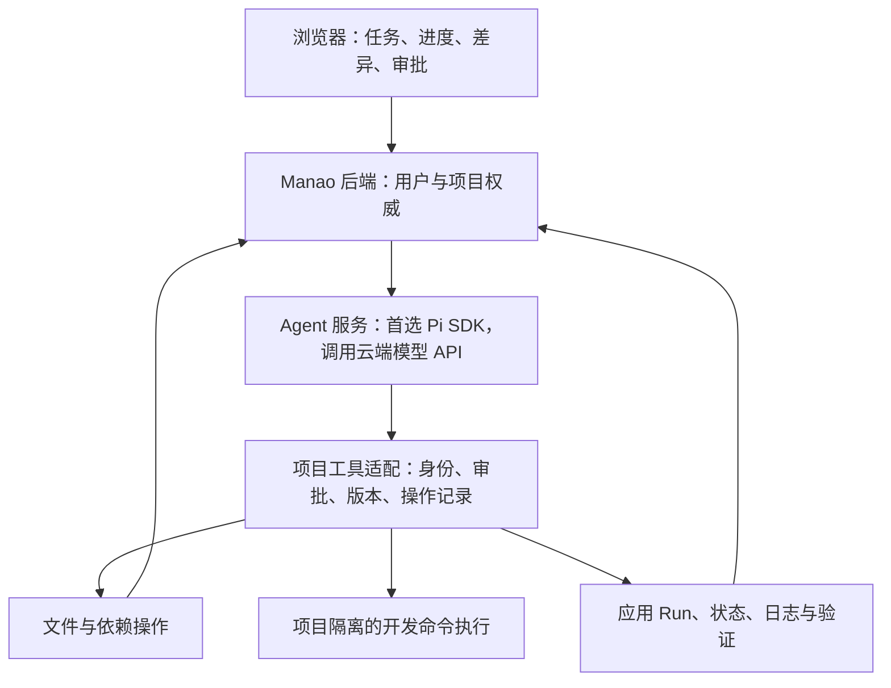

# Manao 自主编程 Agent 集成选型评估

日期：2026-10-13。Manao 调研基线：`master@5e08a9e`。状态：**选型建议与设计输入，尚未选定框架、实施集成或部署验收。**

## 1. 结论

**建议以 Pi 的 `pi-coding-agent` SDK 作为首选，先验证与 Manao 的项目工具契约接通；DeerFlow 保留为第二候选，Vercel AI SDK 为另一条集成路线，LiteRT-LM 不符合本轮云端 API 前提。自主实现整套 Agent 循环放在最后。**

首选 Pi 的依据是：Manao 已经有浏览器工作台、项目与文件权威、应用 Run、日志和资源生命周期；现在缺少的是能持续读代码、修改、执行、观察结果并修复的编程内核。Pi 直接提供这一内核、上下文压缩、会话、Skills 和工具扩展，也允许完整替换文件与命令工具。这样可以复用编码循环，保留 Manao 现有项目控制边界。

这不是“Pi 功能最多”或“Pi 不需要适配代码”的结论。Pi 的稳定 coding SDK 没有完整云端任务调度、高风险审批产品或工具副作用恢复保证；多 Agent 主要通过扩展接入，独立 `pi-durable` 仍为 experimental。若第一版就要求复杂多 Agent、持久任务事件与恢复管理，并愿意让 DeerFlow Gateway 承担这些职责，DeerFlow 可能更省实现工作，见第 5 节。

本轮核实了当前官方源码及文档，没有执行第三方安装脚本、调用模型 API、运行四方案的集成测试或操作 Manao 集群。推荐是有源码依据的架构判断；实际编程成功率、成本、延迟和集成工作量仍待同条件试验。

## 2. 本轮用户确认的目标

以下以本轮直接确认优先，不把附件中其他 Agent 的建议视作当前指令：

1. 跳过 Go、TypeScript 语言适配，直接进入 AI 集成选型与设计。
2. 用户在浏览器下达编程目标，Agent 在当前用户项目内自主读写代码、管理依赖、执行 Shell、运行和修复；不将首版方向收窄成只读聊天或报错解释。
3. 普通项目操作自动执行；破坏性或其他高风险操作需确认；禁止操作 Manao 平台本身。范围包括用户项目的代码、执行环境与项目 MySQL/Redis，不包括平台数据库、平台源码和集群管理面。
4. **仅调用云端模型 API，不考虑本地大模型推理。**
5. 扩展以编程为中心：MCP、Skills、多 Agent、更多项目工具、更复杂的任务。
6. 候选确认为 `vercel/ai`、`earendil-works/pi`（原 `badlogic/pi-mono`）、`bytedance/deer-flow`、`google-ai-edge/LiteRT-LM`；优先复用开源方案，自研最后考虑。

附件是此前讨论摘要，用于理解“自主完成编程目标”的来历。其旧 Manao 提交、旧阶段状态和 LangChain/LangGraph 学习路线不覆盖当前仓库事实，也不构成选定语言、框架或部署的决定。

## 3. 源码快照与比较口径

四个仓库均克隆到 `D:/DeepLearning/MyProjects/Project_Manao_ai_references`，作为可继续查阅的参考副本。比较按固定源码提交，不把主分支开发内容当作已验证的稳定发行包。

| 候选 | 固定提交 | 源码中的版本标记 | 许可证 |
| --- | --- | --- | --- |
| [Pi](https://github.com/earendil-works/pi/tree/7d75a0e3eb273dff753d49c066ea29fbe7b3b6f6) | `7d75a0e3` | coding-agent / agent-core / ai / durable `1.2.0`；durable 另标 experimental | MIT |
| [DeerFlow](https://github.com/bytedance/deer-flow/tree/b7e3d933662111f981bd1659099a6fbecd248307) | `b7e3d933` | app `2.2.0-dev`，独立 harness `2.1.0` | MIT |
| [Vercel AI SDK](https://github.com/vercel/ai/tree/6617f11b68273e743a66a271b2b5d91d1e1c6d44) | `6617f11b` | `ai@7.0.138`，`@ai-sdk/workflow@2.0.70`，`@ai-sdk/harness-pi@1.0.151` | Apache-2.0 |
| [LiteRT-LM](https://github.com/google-ai-edge/LiteRT-LM/tree/a484d21d5113886348fe4c56af61830e45e664a8) | `a484d21d` | README `v0.18.0` | Apache-2.0 |

Pi 旧仓库入口经 GitHub API 解析到 `earendil-works/pi`。Context7 用于当前文档检索，随后核对本地固定源码；Pi 检索结果包含已删除的旧 experimental 路径，因此恢复能力以当前独立包源码为准。LiteRT-LM 参考副本只需源码；预编译 LFS 文件保留指针，不运行其中的二进制。

### 按 Manao 需求比较

| 维度 | Pi coding SDK | DeerFlow v2 | Vercel AI SDK 7 | LiteRT-LM |
| --- | --- | --- | --- | --- |
| 主要定位 | 可嵌入编码 Agent | 可嵌入 harness + 完整 Agent 应用/runtime | 模型/工具/UI SDK + workflow + 多 harness 适配 | 端侧模型推理引擎 |
| 现成编码循环 | 有，文件/命令工具、上下文与会话围绕编程 | 有通用工具循环、文件/Shell/计划/子任务；需对齐项目交付语义 | ToolLoopAgent 提供通用循环；HarnessAgent 可复用 Pi 等编码引擎 | 不提供所需云端编程任务体系 |
| 云端模型 API | 多 provider / compatible endpoint | LangChain model adapters | 多 provider，可直接连接；不强制 AI Gateway | 主要解决本地模型文件与 CPU/GPU/NPU 推理 |
| Skills / MCP | Skills 与当前 MCP 支持；SDK 必须显式装配内置扩展 | 原生 Skills/MCP，集成入口不同会影响自动装配范围 | MCP 包、provider skill 上传、harness skills；三者语义不同 | 不解决本轮项目工具集成 |
| 多 Agent | 稳定编码包提供示例扩展；非完整原生调度产品 | 原生 subagent/runtime/batch 能力较强 | 可组合子 Agent；官方通用子 Agent 模式有审批限制 | 非目标层 |
| 高风险审批 | tool_call hook 可拦截；浏览器与持久审批需接 | guardrail allow/deny 可接；澄清卡不能代替强制审批 | 核心审批与 WorkflowAgent 审批有现成协议；需接业务权限 | 仍需另建 Agent 层 |
| 恢复 | JSONL 会话继续；可靠任务恢复另需设计或实验 durable 包 | checkpoint、存储和 Gateway run/event 管理较完整；死 worker 收敛为 error，不等于透明续跑 | WorkflowAgent + 独立 Workflow runtime；不是核心 SDK 默认保证 | 不解决任务恢复 |
| 与现有 Manao 重叠 | 较少，主要新增编码 worker 与项目工具适配 | 完整 Gateway/沙箱/线程/存储与 Manao 有较多接缝 | UI 适配较好；自建循环需要更多编码行为，复用 harness 则再引入上游内核 | 与本轮前提不匹配 |
| 本轮建议 | **首选验证** | **第二候选，复杂任务管理优先时可反超** | 可选集成层或备选；不为它重写编码内核 | **排除** |

没有用 star 数、宣传语或未经实测的性能分数决定排名。核心标准是：在保留 Manao 项目契约的前提下，能复用多少目标能力，以及必须维护多少新增边界。

## 4. Pi：推荐复用编码内核，明确保留的接入工作

Pi SDK 能创建会话、接收任务、流式报告工具执行、处理后续消息、压缩上下文和中止执行。[SDK 文档](https://github.com/earendil-works/pi/blob/7d75a0e3eb273dff753d49c066ea29fbe7b3b6f6/packages/coding-agent/docs/sdk.md#L26-L116)明确区分会话存储、事件与资源装配。底层[工具循环](https://github.com/earendil-works/pi/blob/7d75a0e3eb273dff753d49c066ea29fbe7b3b6f6/packages/agent/src/agent-loop.ts#L176-L307)真实执行工具并将结果带入下一轮，不需要 Manao 自写基础模型循环。

接入应使用完整自定义工具包装，而不只是把默认工作目录改成用户项目：

- 自定义 `ToolDefinition.execute` 能取得 `toolCallId`，适合绑定 task/project 与持久操作身份；同名工具可覆盖内置工具。[工具签名](https://github.com/earendil-works/pi/blob/7d75a0e3eb273dff753d49c066ea29fbe7b3b6f6/packages/coding-agent/src/core/extensions/types.ts#L640-L656)、[覆盖实现](https://github.com/earendil-works/pi/blob/7d75a0e3eb273dff753d49c066ea29fbe7b3b6f6/packages/coding-agent/src/core/agent-session.ts#L3529-L3553)。
- 内置 read/edit/write/bash 的 operations 接口支持远程实现，但不自带 Manao 的 expectedRevision、operation receipt 或项目权限。仅替换文件 IO 仍不足以获得这些保证。[WriteOperations](https://github.com/earendil-works/pi/blob/7d75a0e3eb273dff753d49c066ea29fbe7b3b6f6/packages/coding-agent/src/core/tools/write.ts#L23-L47)。
- 当前 SDK 可装配 MCP、tool search、codemode；这并非默认调用 `createAgentSession()` 就自动具备全部 CLI 扩展。[SDK MCP 装配](https://github.com/earendil-works/pi/blob/7d75a0e3eb273dff753d49c066ea29fbe7b3b6f6/packages/coding-agent/docs/sdk.md#L112-L116)。
- Skills 和工具扩展适合逐步补 Java/Python 项目知识、验证工具、代码审查工具。多 Agent 可先从只读探索/审查与单一写入者开始；仓库有[子 Agent 示例](https://github.com/earendil-works/pi/blob/7d75a0e3eb273dff753d49c066ea29fbe7b3b6f6/packages/coding-agent/examples/extensions/subagent/README.md#L1-L13)，不能据此宣称完整调度、隔离和恢复已经交付。

Pi 主要缺口是任务管理与执行一致性。稳定 SDK 的 JSONL 保存对话上下文，没有把远端文件修改与会话结果放进同一个事务。`pi-durable` 有持久 intent、safe/unsafe replay 和子任务机制，但[明确标注 API experimental](https://github.com/earendil-works/pi/blob/7d75a0e3eb273dff753d49c066ea29fbe7b3b6f6/packages/durable/README.md#L1-L7)，[重放实现](https://github.com/earendil-works/pi/blob/7d75a0e3eb273dff753d49c066ea29fbe7b3b6f6/packages/durable/src/harness/tool.ts#L130-L185)也仍要求外部副作用具备幂等性。不能把 durable 的能力与 coding SDK 的 Skills/MCP 当作同一入口自动组合。

因此首选 Pi 的含义是先复用其成熟编码路径，并验证薄接入是否足够；如果可靠任务层最终需要写成另一个通用 Agent 框架，就应重新比较 DeerFlow，而不是坚持“轻量”导致大量自研。

## 5. DeerFlow：第二候选及可能反超的条件

当前 DeerFlow v2 已有文件与 Shell、计划、MCP、Skills、原生子 Agent、上下文管理与真实持久化。它能做编程，不能用旧版 deep research 定位直接淘汰。需要分清三个接法：

| 接法 | 可复用 | 不能自动算入的能力 |
| --- | --- | --- |
| `create_deerflow_agent` | 明确传 tools/model/checkpointer/middleware，关闭默认 sandbox，组合 subagent runtime | 完整 Gateway 的 run store、SSE 重放、goal 调度和生命周期管理 |
| `DeerFlowClient` | 嵌入式配置装配、checkpointer、MCP/Skills/subagents 与客户端能力，无须启动原 UI/Gateway | Client.stream 并不走 Gateway RunManager/StreamBridge 路径，不能等同完整服务 runtime |
| 完整 Gateway，Manao 代理内部接口 | 线程、Agent run、事件流、取消、目标 continuation 和存储等较完整机制 | Manao 身份/项目映射、工具执行、审批、文件回执与应用 Run 仍需适配 |

公共 factory 的[参数与边界](https://github.com/bytedance/deer-flow/blob/b7e3d933662111f981bd1659099a6fbecd248307/backend/packages/harness/deerflow/agents/factory.py#L67-L128)说明了可裁剪性；[DeerFlowClient](https://github.com/bytedance/deer-flow/blob/b7e3d933662111f981bd1659099a6fbecd248307/backend/packages/harness/deerflow/client.py#L177-L242)强调不传 checkpointer 时多轮调用无状态。Client 的同步流与 Gateway runtime 的区别见[stream 实现说明](https://github.com/bytedance/deer-flow/blob/b7e3d933662111f981bd1659099a6fbecd248307/backend/packages/harness/deerflow/client.py#L950-L979)。

DeerFlow 内置 SQLite/Postgres checkpoint 确实接入了实际 saver，不只是引用 LangGraph 支持持久化。[async provider](https://github.com/bytedance/deer-flow/blob/b7e3d933662111f981bd1659099a6fbecd248307/backend/packages/harness/deerflow/runtime/checkpointer/async_provider.py#L155-L216)。其 Gateway 多实例路径另有 Postgres、Redis stream、heartbeat 和持久事件等条件；[官方说明](https://github.com/bytedance/deer-flow/blob/b7e3d933662111f981bd1659099a6fbecd248307/README.md#L551-L573)将死 worker 的 run 收敛为 error，并未承诺任意副作用透明续跑。

两个接入成本不能省略：默认 sandbox 的写接口没有 Manao revision/receipt；高风险审批也不能用现成澄清卡代替。[GuardrailDecision](https://github.com/bytedance/deer-flow/blob/b7e3d933662111f981bd1659099a6fbecd248307/backend/packages/harness/deerflow/guardrails/provider.py#L47-L54)是 allow/deny，需接入 Manao 的持久审批状态。默认 K8s provisioner 自己管理 sandbox Pod/Service/线程存储，不是复用现有 workspace-agent 的即插即用适配器。

**若首期就需要原生多 Agent 调度和较完整的任务事件管理，且接受 DeerFlow Gateway 作为 Agent 专用运行服务、使用其 SQLite/Postgres 状态存储，那么应优先试 DeerFlow。** 这时它提供的能力实际替代了本来要写的代码。当前将这些作为后续扩展，首个交付聚焦单项目编码闭环，Pi 与既有 Manao 的职责衔接更直接。

## 6. Vercel AI SDK：当前能力很强，区分自建循环和复用 harness

当前源码不能概括为“只做聊天”：

- `ToolLoopAgent` 负责模型—工具循环、停止条件、运行上下文和工具审批。
- `WorkflowAgent` 提供依赖独立 Workflow runtime 的持久执行与审批；不是所有 `ai` 调用天然具有恢复能力。
- `@ai-sdk/mcp` 提供 MCP 工具适配；React 流式 UI 与现有 Manao 前端有较好匹配。
- `HarnessAgent` 可包装 Pi、Claude Code、Codex 等现成编码引擎。[概览](https://github.com/vercel/ai/blob/6617f11b68273e743a66a271b2b5d91d1e1c6d44/content/docs/03-agents/01-overview.mdx#L94-L104)。

如果仅用 ToolLoopAgent，Manao 还需组装编码工具、上下文策略、会话、项目执行与任务管理，整体比直接复用 Pi 编码内核更接近自建。如果使用 `@ai-sdk/harness-pi`，编码核心实际仍是 Pi，同时引入 AI SDK 的统一 UI/harness/sandbox 契约；这种组合有价值，但不应被统计成“Vercel 自己提供了另一个已验证编码引擎”。

该适配器已支持 Pi 在 host Node 进程中使用远程文件系统和 Shell，无须在 sandbox 安装 bridge。[Pi adapter README](https://github.com/vercel/ai/blob/6617f11b68273e743a66a271b2b5d91d1e1c6d44/packages/harness-pi/README.md#L1-L3)。不过 [harness 包仍为 experimental](https://github.com/vercel/ai/blob/6617f11b68273e743a66a271b2b5d91d1e1c6d44/packages/harness/README.md#L1-L5)，自定义 sandbox 仍需实现 Manao 的文件事务和命令边界。对本轮“选择一个核心”的要求，建议先选 Pi；有多编码引擎切换或统一 AI SDK UI 的实际需求时再比较这一外层。

Workflow 可以自托管，不强制部署到 Vercel。[官方部署文档](https://workflow-sdk.dev/docs/deploying)提供 Worlds 与 `@workflow/world-postgres` 路径，承担存储、队列和通信；这会给当前 MySQL/K8s 系统增加运行时和持久设施的接入工作。本轮没有验证其 K8s 部署。持久 step 重放也不能保证任意外部副作用 exactly-once。

未来多 Agent 还需关注一个具体边界：当前[官方通用子 Agent 模式](https://github.com/vercel/ai/blob/6617f11b68273e743a66a271b2b5d91d1e1c6d44/content/docs/03-agents/06-subagents.mdx#L333-L339)明确不支持子工具 approval flow。不能据此断言所有 harness 都无审批，但不能直接把主 Agent 的审批能力推广到该模式的子 Agent。

## 7. LiteRT-LM：本轮排除的原因

LiteRT-LM 是本地推理层，有工具调用支持，但主要解决模型文件加载、跨设备执行、CPU/GPU/NPU 加速。其 [Python Engine](https://github.com/google-ai-edge/LiteRT-LM/blob/a484d21d5113886348fe4c56af61830e45e664a8/python/litert_lm/engine.py#L53-L85)以 `model_path` 和计算 backend 为入口，[README](https://github.com/google-ai-edge/LiteRT-LM/blob/a484d21d5113886348fe4c56af61830e45e664a8/README.md#L1-L54)说明端侧产品定位。

用户已明确排除本地模型，因此它不能替代本轮需要的云端自主编程 Agent 内核。即使其本地推理服务提供兼容 API，也不等于调用外部云端模型的 Agent 编排层。排除基于需求与层级，不是对项目质量的否定。

## 8. 任一候选都必须适配的 Manao 边界

### 8.1 Agent 任务与应用 Run 分开

一个编程任务可能读写多次、构建多次、发起多个应用 Run，并中途等待用户确认。现有 Run 代表一次应用 Job，不能复用它承载整个 Agent 任务状态。拟新增的 AgentTask 及关联关系属于后续设计，不声明已经实现。

Agent 在授权任务内“修复后发起新的 Run”，与基础设施自动重启失败应用不同；需要在新阶段明确这一授权和预算范围，同时保留现有服务型 Run 的时限、端口与项目数据规则。[RunService](../../poc4/backend/src/main/java/com/manao/poc4/run/RunService.java)当前执行 owner、revision、active Run、依赖 readiness 校验。

### 8.2 文件修改复用权威，执行重试不能只靠框架

[WorkspaceController](../../poc4/backend/src/main/java/com/manao/poc4/workspace/WorkspaceController.java)和[WorkspaceOperationService](../../poc4/backend/src/main/java/com/manao/poc4/workspace/WorkspaceOperationService.java)已存在版本检查、PENDING、agent receipt 与提交/核对流程。但普通文件 API 和 Run 创建并非都接收调用者提供的稳定 operationId；新增 Agent 工具必须设计 task/toolCall 到现有操作的持久映射。不能假设调用一个现有 HTTP API 就获得 Agent 重放去重。

审批需绑定确切 task/project、工具及参数、必要的 revision；批准前后仍需服务端校验权限与版本。模型压缩历史、JSONL、LangGraph checkpoint 或 Workflow step 都不能替代实际文件、项目 DB 和远端命令的结果核对。

### 8.3 自由 Shell 与项目版本协议是最大设计接缝

[TerminalSessionService](../../poc4/backend/src/main/java/com/manao/poc4/terminal/TerminalSessionService.java)只对 READY 项目的 RUNNING Run 提供终端，云前端默认关闭终端。Agent 在修改、构建甚至启动应用之前就需要命令执行能力，不能简单复用这个终端作为完整开发环境。

Shell 可通过重定向、脚本或构建工具改变源码。仅给 edit/write 加 revision 检查，再向 Shell 暴露可写 live PVC，会绕过现有协议。后续设计需要在以下两种方向中验证一个：

- **任务工作副本**：在项目隔离的副本中自由编辑/构建/测试，再将变更通过项目版本与回执协议提交；普通变更可在任务授权内自动提交，不要求每次人工确认。
- **受控项目命令协议**：命令进入项目写租约、intent、变更识别和 receipt 协调边界；异常后先核对再继续。此协议是新增能力，不能把它当作已有 Shell API。

这项成本对 Pi、DeerFlow 和 AI SDK 都存在，是 Manao 集成领域能力。不得以“少造轮子”为由跳过，也不应把它膨胀成自行重写整个通用 Agent 框架。

### 8.4 复用关系示意

上图是建议边界，不是已批准实施架构。保留当前 React/Vite 与 Spring Boot，不要求移植 Pi 到 Java，也不要求迁移前端到 Next.js。云端模型密钥位于 Agent 服务；执行用户代码的环境仅得到当前用户项目的能力。MCP、子 Agent 和 Skills 的执行仍经过同一边界；cwd、提示词或 skill 描述不构成平台隔离。

## 9. 下一步建议与选型退出条件

下一项是 **Pi 与 Manao 项目工具的最小集成方案及验证设计**，随后在实现授权后执行。先让单 Agent 完成真实 Spring Boot 书籍 CRUD；Java/Python 仍是已交付的两类用户项目，Go/TS 不再前置。

建议验收一条明确链路：用户目标 → 读取项目 → 修改与依赖处理 → 构建/测试 → 启动 Manao 应用 Run → 读取失败或业务结果 → 修复 → 新 Run → 展示文件版本、修改清单和真实验证证据。结束消息不能直接记为任务验收成功。

最小验证还应覆盖与此次新增能力直接相关的行为：普通操作自动、高风险操作等待并可拒绝、用户编辑版本冲突、active Run 锁写、写已生效但响应丢失后的核对、取消远端执行、Agent 重启后的安全继续、浏览器重连，以及项目工具不能触达平台资源。首个闭环可用一个任务预算与单一写入者；多 Agent 的并行写隔离在其实际引入时验证。

以下结果会推翻 Pi 首选：稳定 SDK 所需任务/事件/恢复代码显著扩大成通用编排系统；首期多 Agent 调度成为核心刚需；或 DeerFlow Gateway 适配在相同模型、项目工具和异常条件下明显减少维护代码。届时优先转向 DeerFlow，不为既有推荐继续堆自研。

尚未决定但不阻碍本轮推荐：具体云端 provider/model、任务预算、破坏性/高风险分类、任务副本与命令协议选择、首版的重启恢复目标，以及 Pi 稳定 SDK 与实验 durable 的采用边界。以上进入下一轮设计，不伪装成已确认要求。
