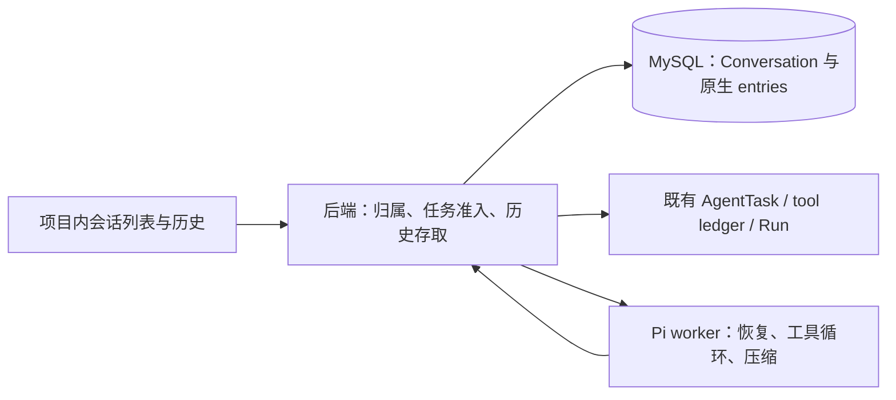

# AI 多会话与上下文管理设计

日期：2026-10-19。状态：已实施并完成本地验证/独立审查；另获用户授权后完成三镜像部署、V13运行库迁移和真实模型/browser主链round3（1/1）。两轮harness失败保留，真实云端75%自动触发仍NOT_RUN。实际证据及流程偏差见[Context acceptance](../../../poc4/docs/evidence/ai-context/acceptance.md)§7。

## 1. 目标、确认与基线

本轮解决一个问题：用户在同一项目打开不同 AI 会话，重新进入后能看到历史，并在原会话继续编程；历史变长时压缩模型需要读取的上下文，保留原始记录。

用户在本轮明确确认：

- 同一会话可连续发送多个编程目标，每轮使用新的 AgentTask，共享该会话上下文。
- 不同会话只共享项目代码，不共享聊天历史；“暂不考虑跨任务”不再解释为禁止同一会话的多轮 AgentTask。
- 手动压缩只在会话空闲时可用；运行中的自动压缩在 Pi 的安全边界处理。
- 沿用引用聊天中的固定 1M 窗口与 75% 自动压缩要求，不提供用户配置。
- 规划之后，用户明确授权功能实施、本地验证、顺序评审和发布准备；未授权真实模型调用、部署/重启、运行库迁移、push/merge或项目删除。

工作目录为仓库中的 `.worktree/ai-integration`，分支 `codex/ai-integration`，规划代码基线 `c5a76fd`；开始规划时工作树干净。主检出 `master@49eb632` 不包含这份 AI 实现，不在主检出修改功能。两段直接依据为聊天 `ai集成--阶段二实现`（`01a1438e-1482-70f1-9c68-cd0a8e63f40f`）和 `ai集成--chatbot启发`（`01a151be-c543-7780-8b90-699ac88a5463`），已通过 read_thread 读取。

第一阶段已有实际验收；第二阶段实现和部署已交付，但工程验收仍为 PAUSED / NOT_GRANTED；第三阶段是用户确认书籍 CRUD 的使命完成。见 [Progress](../../what-we-have-done.md)、[阶段二记录](../../../poc4/docs/evidence/ai-stage2/acceptance.md) 和 [阶段三确认](../../../poc4/docs/evidence/ai-stage3/acceptance.md)。上下文管理是新增切片，不把这些记录改为全部 PASS，也不顺带实施第四阶段接管/续跑。

## 2. 从最小职责选择方案

| 方案 | 结果与取舍 |
| --- | --- |
| MySQL 保存 Pi 原生 entries，Pi 重建上下文并压缩（采用） | 增加会话归属、持久化和界面；复用现有任务/工具和 SDK，不维护第二份消息历史 |
| worker JSONL 作为会话权威 | 需要更改当前 emptyDir、备份/挂载及后端检索边界；对当前目标没有优势 |
| 自建 Message/摘要/检索引擎 | 与 Pi 的消息结构和压缩边界重复，首版没有跨会话检索需求 |

借鉴 Manao-chatbotdemo 的会话列表和结构化消息展示，不移植其 Next.js、数据库层、AI SDK 或附件/分享功能。现有 Spring Boot、MySQL、Pi worker 和 React 查询链路继续使用。

## 3. 产品行为与明确舍弃

新建空会话不调用模型。发送第一条目标时，以第一条目标前 40 个 Unicode 字符作为标题；未发送时显示“新会话”。支持列表、新建、切换、分页查看、继续发送和空闲手动压缩。暂不做重命名、单会话删除、归档、搜索、分享、附件、消息编辑/重新生成和分叉。

一个 Project 有多个 Conversation；一个 Conversation 有多轮 AgentTask。会话不是任务状态机。沿用项目级一个占用任务和 worker 全局一个执行槽；切换或新建会话不停止现有任务，不启动并发执行。同项目其他会话运行时，也不能发起手动压缩。不同项目同时争用 worker 时沿用当前拒绝行为，不加队列或执行池。

新一轮重新使用后端保存的当前 workspace revision，固定系统指令要求重新读取有关文件再修改。历史中的文件内容、Run 或成功结果不代表当前项目事实；工具、receipt 和 Run 继续作为执行权威。会话没有私有工作区。

新功能不把旧任务的截断 progress 伪造成完整会话。不批量回填旧任务，不改变旧验收脚本的 task-only 路径。旧任务仍可通过原接口读取；新会话功能从启用后开始保存完整 SDK 消息。

## 4. 唯一持久历史与数据边界

增加 V13 migration，只新增两张表并给 agent_task 增加 nullable conversation_id：

| 表/字段 | 职责 |
| --- | --- |
| agent_conversation：id、project_id、title、created_at、updated_at | 会话身份；owner 从 project 关联校验，不复制用户授权 |
| header_json、head_seq | 一个 Pi SessionHeader 和已确认追加的位置；Pi session id 固定为 conversation id |
| context_tokens、usage_head_seq | 有来源的最近上下文占用；可空，不当作累计消费 |
| compact_request_id、compact_base_seq、compact_state、compact_worker_instance、compact_failure_code | 当前/最近一次空闲手动压缩的最小请求记录；不建通用 operation 表 |
| agent_conversation_entry：conversation_id、seq、entry_id、source_task_id、writer_id、payload_json | 按顺序保存原生 SessionEntry；主键 (conversation_id, seq)，唯一 (conversation_id, entry_id) |
| agent_task.conversation_id | 编程轮次与会话的关联；旧任务为 NULL，原请求仍有效 |

project→conversation 和 conversation→entry 使用 ON DELETE CASCADE；task→conversation 使用 nullable 关联、ON DELETE SET NULL。项目删除按现有资源回收契约执行，本轮不新增用户删除入口或清理任务，不执行任何既有项目删除。

原生 payload 保留 message、toolResult、compaction、system/tool loadout、usage、context_edit 等 Pi 1.2.0 实际产生的结构与稳定 id/parentId。保留中文、结构化 content、toolCallId、thinking/signature 及压缩边界，供 SDK 内部恢复；不把这些内部字段直接返回浏览器。只接受固定 SDK 版本的已知 entry 类型，不开放分支编辑接口。

用户目标在创建 AgentTask 的同一事务中追加为 Pi 原生 custom_message（customType=manao_user_request，entry id=taskId，details.taskId 关联轮次）。它本身参与模型上下文，因此 worker 尚未启动就失败的目标也能显示和恢复。创建会话时由后端写固定 Pi v3 header（id=conversationId，cwd=manao-project，timestamp=created_at）；worker 用实际 scratch cwd 恢复，不改写原 header。

浏览器历史是读取时的安全投影：上述用户目标、assistant 的 text、工具名称/调用 ID和压缩标记。每轮状态由历史taskId关联既有owner-scoped TaskSnapshot读取，不制造会随状态变化的原生seq项。worker 在新会话路径调用 prompt 时只发送固定的“执行上文最新记录的用户编程目标”触发消息，不重复加入目标正文；这一内部触发消息不展示。旧 task-only 路径仍发送原 prompt。工具详情沿用现有 owner-scoped result route 的字段白名单；不在会话 DTO 暴露原生 system/thinking/signature、worker 路径、执行 UID、连接信息或凭据。代码/HTTP body 继续按文本渲染。

原始消息长期保留至项目删除；压缩仅改变下一次模型请求的投影，不删除、改写或截断原始历史。这里的“完整”指已完成的 SDK 消息和原工具返回的内容，工具自身原有 128 KiB/64 KiB 等限制不被取消；流式半条消息不承诺逐 token 持久化。

## 5. 追加协议与可靠保存时点

internal API 返回有界分页的原生 entries；worker 按 seq 恢复全部已保存 entries，使用 `SessionManager.inMemory(cwd, { id }, fileEntries)`。首版不额外建 checkpoint、投影缓存或独立 JSONL 副本；模型看到的仍是 Pi 压缩后的有效投影。历史越来越长时的 worker 恢复成本需要测量后再优化。

追加请求携带 expectedHeadSeq、稳定 entry IDs及可空usage；source task/writer由后端已验证身份推导。ConversationStore使用独立READ_COMMITTED事务，保留project→conversation→task/entries锁顺序，原TaskStore事务不改。事务锁定conversation，校验项目/任务/worker 身份，整批插入并更新 head_seq。完整相同批次重放返回原确认；同 ID 不同 payload、乱序、跨会话 parent、过期 writer 或 head 冲突返回固定错误，不覆盖。JSON payload 按解析后的值比较，避免 MySQL JSON 键排序造成误判；无需另建消息 digest 平台。

现有任务的 epoch/instance 校验继续使用。新任务准入、conversation 归属和手动压缩占用检查须在同一个现有 project-row 事务内完成；只做 service 层的前置读取不足以防并发。

生产保存接在可以 await 的边界：

1. 用户目标随任务准入事务保存；第一条模型请求前再保存 SDK 的内部触发消息及追加项。
2. 每个项目工具实际调用后端前，保存模型发出的 assistant/toolCall 记录。
3. 下一条模型请求前，保存所有工具结果及已完成的压缩条目。
4. `session.prompt()` 或手动 `compact()` 返回后，保存最终回答/压缩结果，再发送 terminal 或成功状态。

将已有 `session.agent.prepareRequest` 包装为“调用原实现→flush→返回”，并包装原 `streamFunction`，使绕过prepareRequest的原生摘要及其重试也先等待ACK，保留SDK上下文投影；工具invoke前增加beforeInvoke await；结束时独立saveFinal，即使先前工具fatal也保存已完成失败消息。不得用 `session.subscribe(async ...)` 充当保存屏障：Pi 的 listener 返回 void，而且 message_end 通知先于原生 append。SDK 合同测试必须覆盖这个真实顺序。

保存超时先查询原 IDs/head，已落盘则确认，确认未写入才重发同一批次；不能确定时中止本轮，使用现有 FAILED/NEEDS_ATTENTION 与收尾，不继续新工具/模型请求或假报成功。已执行工具仍以原 ledger/receipt 对账，不能因缺一条聊天记录重做。

worker 突然退出时最多缺少尚未到下一保存屏障的完整消息；任务/工具 ledger 不因此消失。保留中断提示。历史能重新打开不代表原任务自动恢复。只有原任务按既有流程停止/close 后，用户才能发起新轮。若恢复的尾部存在未配对 toolCall，在创建AgentSession之前使用Pi的appendContextEdit(targetId, null)，原生entry字段为replacement:null，省略该未完成工具轮在有效上下文中的贡献，并追加“上轮中断、结果需重新读取”的 custom message；保存这些追加项后才处理新目标。原始历史不删、不伪造成功 toolResult、不调用旧工具。

## 6. 固定窗口、自动压缩和占用展示

产品中的 1M 固定取 1,048,576 tokens；75% 阈值为 786,432。当前 model runtime 的 `contextWindow: 200000` 改为 1,048,576，maxTokens 仍为 8192。Pi 及三个相关包保持 1.2.0，不因文档出现新 API 升级。

继续复用 Pi 原生自动压缩；`keepRecentTokens` 保持其当前默认 20,000。Pi 1.2.0 的 shouldCompact 使用严格 `>`，因此 `reserveTokens = 1,048,576 - 786,432 + 1 = 262,145`，使整数占用在 `>= 786,432` 触发。这项映射必须由 SDK 行为测试证明。摘要模型仍为当前云模型，不引入路由或第二个模型配置。

判断对象是当前有效上下文，包含 SDK 的 system/tool loadout、最新摘要、保留消息和新增内容；优先使用 provider usage 校准，未计量部分由 Pi 估计，不把历次消耗相加。无有效 usage 时显示“约”或“占用暂不可用”；Pi 在压缩后可能返回 tokens=null，不能显示成 0，也不能沿用压缩前的百分比。

首轮先在idle、prompt之前检查当前SDK上下文加待发trigger和初始system/tool声明，必要时public session.compact；活动prepareRequest只能fail-closed，不能在其内部compact导致中止当前run。工具增长和后续响应继续由Pi原生loop压缩，不在toolCall及其结果之间压缩。保留 Pi 原生摘要与重复压缩的 previousSummary/firstKeptEntryId 语义，不另写摘要链/切片算法。用含 read_file/write_file/build/application 的实际消息测试目标、约束、文件变化、验证结果和未完成事项的延续；不能依赖只识别 read/write/edit 的原生文件名提取器，也不为此新增文件索引。

摘要失败不追加成功压缩记录、不删除旧上下文。自动压缩失败且仍超过阈值时，本轮报固定 AI_CONTEXT_COMPACTION_FAILED 并走既有任务收尾，不能无界重试或继续向超限模型请求；下一轮由用户处理。成功摘要必须先经过保存屏障，才能进入下一次请求。自动摘要耗时计入原 1800s，原 180 次工具/20 次 build 预算不变；stop/deadline必须同时终止Pi独立compaction和agent请求；实际deadline timer记录expired事实，不能因now恰等于截止毫秒把到期误报为普通stop。

## 7. 空闲手动压缩

浏览器生成 requestId，并提交 expectedHeadSeq；后端在短 project gate + project-row 事务中确认项目没有占用 AgentTask/手动压缩，保存该请求 RUNNING，然后锁外调用 worker。worker 的同一个执行槽接受 task 或 compact 两种工作，不加队列。压缩只恢复历史并调用 compact，不 prompt、不启用项目副作用。

worker 异步接受，浏览器通过会话详情查询状态，模型处理限时 120s。完成后 worker 回传原 requestId/baseSeq/instance，后端在同一事务追加摘要、更新 head/usage 和 COMPLETED；失败记录 FAILED 并保留旧历史。用户重复点击/丢响应查询同一 requestId，不自动创建另一请求。已成功请求可从 writer_id 对应的压缩 entry 识别；失败后显式再次点击才创建新 requestId。

若 POST 未知且 GET 尚未登记，保留原 conversationId/requestId/baseSeq 和项目占用；用户可显式“重试原压缩请求”，仅重发原身份，由已有后端幂等准入避免重复摘要。刷新/切换会话仍操作该原请求；GET 不同/null 不能单独释放。retry 被拒绝时，原请求终态或成功 GET 证明 head 已变化、旧 base 永远无法再准入才释放；同 head 的 busy/鉴权拒绝和查询失败继续待对账，不自动重试、不产生新身份，异步 A 结果不污染 B。

开始新任务时检查项目全部会话的 RUNNING 压缩；同时到来的任务/压缩最多一个获得准入。这里占用的是会话写入条件，不赋予源码写入能力，也不因摘要而停止 ready 应用。worker 其它项目执行中时明确返回忙，结束请求为 FAILED，用户稍后重试。

后端重启后在查询/新轮准入时，只读核对原压缩请求的 worker 状态；同实例在途则继续等待，确定拒绝/失败或原实例已消失则标记 FAILED 并封住迟到写入。超时/连接失败不能当作 worker 已退出，保留请求待核对；不加入后台通用 reaper。请求完成、被判失败或新 requestId 接替后，旧回调均不得写入。worker 重启不自动重做摘要。

## 8. 最小接口与尺寸界限

浏览器沿用 JWT/同源 `/api`，增加：

| 方法与项目内相对路由 | 含义 |
| --- | --- |
| POST /conversations | `{ conversationId }`；幂等创建，空会话无模型调用 |
| GET /conversations?before=…&limit=20 | 按 updated_at/id 逆序，返回 nextCursor；最大 50 |
| GET /conversations/{id} | 会话元数据、lastTaskId/activeTaskId、headSeq、usage、手动压缩状态 |
| GET /conversations/{id}/entries?beforeSeq=…&beforeOffset=…&limit=50 | 展示投影，seq+textOffset组合分页；最大100，返回nextBeforeSeq/nextBeforeOffset；offset为null保留旧seq逻辑 |
| POST /conversations/{id}/tasks | 复用原 TaskRequest；conversationId 从 route 注入服务，加入新任务请求绑定 |
| POST /conversations/{id}/compact | `{ requestId, expectedHeadSeq }`；异步接受或固定冲突 |

路由前缀 `/api/v1/projects/{projectId}`。TaskSnapshot/WorkerStart 增加可空 conversationId，旧 request/调用构造方式与 task-only 验收兼容；旧请求 digest 保持不变，新请求将会话身份纳入 digest。

internal 前缀 `/internal/ai`：任务 GET/POST `/tasks/{taskId}/context` 读取分页或追加；空闲摘要仅GET `/conversations/{id}/compactions/{requestId}/context`，固定baseSeq读取；POST同路径`/result`在一次事务原子提交完整suffix、usage和终态，没有POST /context。任务路由仍校验 epoch/instance；摘要路由校验预登记 request/instance/baseSeq。worker 增加 POST `/conversations/{id}/compact`、GET `/conversations/{id}/compactions/{requestId}`，沿用原 token 鉴权及单槽。

原生单entry上限2MiB；context页/批及manual result按真实UTF-8 JSON最多4MiB、32entries，浏览器页最多512KiB。长文本读时按64KiB UTF-8安全片段投影，textOffset为不切code point的UTF-16索引；不存第二份历史。append ACK前检查同seq/textOffset不可分工具metadata组的完整HistoryPage序列化字节（含最大cursor），超界整批拒绝；不增加任意identifier长度限制。internal 只对新增 context/result 路由放宽至 4 MiB，既有 calls/progress 保持 512 KiB；不能全局放开。分页或分批不截断单 entry；超单项限制明确失败。数据库写入按 entry 参数化提交，发布前核实 max_allowed_packet 能容纳单项与协议；不默认修改运行库配置。

错误使用固定白名单，包括 AI_CONVERSATION_NOT_FOUND、AI_CONTEXT_CONFLICT、AI_CONTEXT_UNAVAILABLE、AI_CONTEXT_COMPACTION_FAILED、AI_CONTEXT_BUSY 和既有 AI_REQUEST_TOO_LARGE；浏览器不接收原异常。不同 owner/project 的会话统一按不存在处理。

## 9. 验收边界与过度设计检查

必要验证是：两个会话隔离、同会话多轮重启后仍可继续、完整长消息与真实工具结果能回放、压缩后原文仍在、重复压缩不漏边界、阈值含等号、工具循环内触发、持久化失败阻止继续、手动空闲互斥与丢响应对账、中断历史不重放工具、原 Run/receipt/close/预算回归。

真实模型/browser验收使用明确disposable项目；为超过Pi keepRecent20k而产生真实摘要，操作者先通过既有工作区入口准备96–120KiB无秘密ASCII顶层txt，A首轮只read_file一次并核对完整settled结果，harness不写fixture、不改生产窗口。主链：A记住一条约束→重启空闲 worker→A 继续；B 不携带 A 的聊天；A 手动压缩后仍按约束工作且原文可查。自动 75% 的精确边界由固定 1M 配置与注入 usage 的本地 SDK 测试验证，不为测试烧入 786,432 个真实 tokens，也不新增生产小窗口开关。真实自动触发未发生时必须单列 NOT_RUN，不能写成云端 75% 场景已 PASS。

不增加向量库、RAG、跨会话记忆、Agent 编排器、消息队列、同步 JSONL、副本消息表、通用 event store、lease/审批框架、执行池、自动续跑或跨平台重构。顺序/CAS、保存屏障和手动压缩的最小请求状态分别对应现有网络不确定性、SDK void listener 和 compact 中止执行的实际接缝，均有直接必要性。

## 10. API 依据与证据限制

已使用 Context7 查询 [Pi SDK 文档](https://github.com/earendil-works/pi/blob/main/packages/coding-agent/docs/sdk.md) 与 [压缩文档](https://github.com/earendil-works/pi/blob/main/packages/coding-agent/docs/compaction.md)，并以本分支安装的 1.2.0 declarations/JS 核实 SessionManager.inMemory 的 entries 参数、void listener、compact 的 abort、严格阈值和 getContextUsage 的 nullable 结果。在线文档包含比锁定版本新的能力，本方案不使用 durable/background compaction。

规划时的SDK核对已由实施期真实安装Pi1.2.0的scripted-provider合同测试补证；本地阶段只迁移disposable测试schema。随后获授权的集群发布/V13及真实模型/browser主链见[Context acceptance](../../../poc4/docs/evidence/ai-context/acceptance.md)§7，保留本地RED/GREEN、评审、裁定及错误成本；云端75%自动触发未执行。执行步骤见[实施计划](../plans/2026-10-19-ai-conversation-context-implementation-plan.md)。
