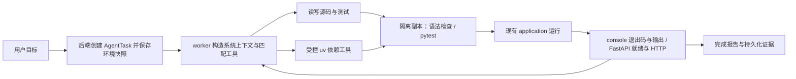

# AI 项目环境与 Python 开发闭环设计

状态：用户已确认设计和实施计划；本地实现与验证完成，后续授权的集群发布、真实模型核心流程和部分恢复专项已执行，见[云端记录](../../../poc4/docs/evidence/ai-python-environment/cloud-20261104.md)。完整云故障矩阵仍未关闭，不以核心流程替代完整验收。

本次调研基线：`master` 的 `d0cf75f`；规划分支 `codex/ai-python-environment`。该提交是本次证据定位，不是未来永久基线。实施前核对实际 checkout 与差异。

实施入口：[实施计划](../plans/2026-11-04-ai-python-environment-implementation-plan.md)。

## 1. 已确认目标与范围

用户要求 Agent 知道当前环境、调用相应工具，并让普通 Python 与 FastAPI 都完成“编辑 → 运行 → 查看结果 → 继续修改”闭环。用户进一步确认：

- Agent 可自动通过受控工具增删第三方依赖，沿用平台 uv 与锁文件机制，无需每次另问。
- Python 验证包含语法检查、pytest 与真实运行反馈；测试依赖按需加入专用 `test` 组。
- 规划完成后，用户先授权指定工作树内实现、本地验证和提交，后续又授权集群部署与真实模型验证；两个授权阶段的证据分别保留。Git push/merge 和共享资源删除未执行。

四类模板全部提供环境事实；Python 两类补齐工具能力；Java 两类保留现有构建、运行语义并回归验证。普通 Python 沿用 `main.py` 非交互入口，FastAPI 沿用 `app.main:app` 及 `/health/ready`。本阶段不扩展任意命令、stdin、CLI 参数配置、框架迁移、Python wheel 发布、任意索引或需要系统包/本地构建的依赖。

## 2. 已核对的现状

| 当前事实 | 源码入口 | 对本设计的影响 |
| --- | --- | --- |
| 四类运行模板已存在 | `RuntimeTemplate`、`ProjectRuntimeSpec`、`RunPolicy.forProject` | 从后端配置派生事实，不让模型猜测 |
| AI 已能启动 Python/FastAPI | `AgentApplicationTools.invoke` → `RunService.startForAgent` → `JobResourceFactory.createJob` | 复用现有 Run 生命周期 |
| `WorkerStart` 没有项目环境字段 | `AgentContracts`、`server.ts`、`pi-session.ts` | 补充持久化环境快照及传输合同 |
| AI 文件白名单偏 Java | `AgentProjectTools.toolAllowlist` | 分离按模板决定的读、写、目录策略 |
| AI `build` 固定 Maven 镜像与 launcher | `JobResourceFactory.createDevelopmentJob`、`manao-dev-build` | 增加 Python 验证分支，复用执行/清理状态机 |
| Python 依赖操作已有成对提交和 receipt | `PythonDependencyService`、`WorkspaceOperationService`、`PythonDependencyEditor`、`PythonDependencyTransaction` | 复用 prepare/register/commit/reconcile |
| 依赖公开入口要求 `requireBrowserWritable` | `PythonDependencyService.change/reconcile` | 新增绑定 AI task/tool call 的入口，不能直接调用浏览器入口 |
| 当前依赖 helper 仅增删主依赖；运行 `--no-dev` | `python-dependency-helper.py`、`manao-python` | 增加固定 test 组支持，应用运行不安装测试组 |
| 任务收尾只对 `write_file` 调用逐项核对 workspace receipt | `AgentProjectTools.finishForClose` | 必须加入依赖调用；仅注册新工具不够 |
| `hasPendingReceipts` 已按 tool call 的 operation ID 关联所有 PENDING | `AgentTaskStore.hasPendingReceipts` | 可沿用；不能过滤掉依赖操作 |
| 构建预算 20、工具预算 180、任务期限 1800 秒，每任务最多启动应用 4 次 | `pi-session.ts`、`AgentTaskStore` | Python 共用预算，不额外扩大 |

以上是源码事实，不是部署成功或真实模型闭环通过的证据。CodeGraph 在新工作树返回主 checkout 索引提示，本文涉及的新工作树源码已直接核对，不创建索引。

## 3. 方案选择

| 方案 | 收益 | 局限/成本 | 选择 |
| --- | --- | --- | --- |
| 仅加环境提示词与放开文件 | 变更小 | 依赖、测试与错误工具调用仍有缺口 | 不满足已确认目标 |
| 环境快照 + 按环境裁剪现有工具 + Python build + 一个依赖工具 | 复用 Run、构建、receipt 与预算，覆盖闭环 | 需要跨端合同及生命周期回归 | 推荐并据此规划 |
| 开放 Shell / 任意命令或独立 Python agent | 灵活 | 新执行权限与收尾体系，超出现有需求 | 本阶段不采用 |



## 4. 可信项目环境与工具能力

### 4.1 环境快照

新增 `AgentProjectEnvironment` 值对象及派生服务。只读取任务绑定项目的 `ProjectRuntimeSpec`、`RunPolicy` 和固定工具策略，禁止由 prompt、模型参数或浏览器传入 template 覆盖值。

内部 JSON 合同示例（字段为建议正式合同，不代表当前已有）：

```json
{
  "schemaVersion": 1,
  "templateId": "python-fastapi-web",
  "language": "python",
  "framework": "fastapi",
  "executionKind": "service",
  "entrypoint": "app.main:app",
  "pythonVersion": "3.13",
  "primaryPort": 8000,
  "readinessPath": "/health/ready",
  "mysql": false,
  "redis": false,
  "filePolicy": "python-v1",
  "buildGoals": ["compile", "test"],
  "dependencyGroups": ["main", "test"],
  "tools": ["list_files", "read_file", "write_file", "build", "application", "app_http_get", "read_image", "python_dependencies"]
}
```

实际端口取项目配置，不能把示例 8000 写死；解释器版本取平台运行策略。console 的端口和 readinessPath 为 null，entrypoint 为 `main.py`。Java 的 pythonVersion 为 null，framework 为 `none` 或 `spring-boot`，依赖组为空，buildGoals 为 `compile/test/package`。console 不暴露 `app_http_get`；Python 才暴露 `python_dependencies`。

环境不包含密码、连接串、原始 Secret、kubeconfig 或内部挂载路径。MySQL/Redis 的配置布尔值只表示项目选项，不能代表依赖当前健康。依赖包列表与文件内容是可变状态，不冻结进环境；用当前文件/工具结果读取。

### 4.2 持久化与重试身份

新迁移 `V20__agent_project_environment.sql` 给 `agent_task` 增加 nullable `environment_json`、`environment_sha256`。在首次 task 创建的同一事务内写入快照和摘要；已有 task 重试必须返回已保存版本。摘要对规范化、固定字段顺序的 JSON 计算，不依赖任意 Map 遍历顺序。

保留既有 `request_sha256` 的用户意图身份及 terminal report 公式；环境用独立摘要绑定。`WorkerStart` 增加环境和摘要，worker 校验 schema、组合与摘要；同 task/epoch/request 的重复 start 若环境摘要不同，拒绝，不启动第二会话。工具后端始终从持久化 task 取策略，不信任 worker 自报权限。

历史 task 的 null 快照不回填为 Java。已结束 task 可查看历史；原运行/未决 task 仅按原身份收尾；新 worker 拒绝缺环境的新执行。部署安排维护窗口，先完成或接管旧活动任务，再升级各组件；旧会话后续新 task 获取新快照。禁止通过部署自动重跑历史任务。

### 4.3 Pi 接入与压缩

沿用 Pi 1.2.0 `DefaultResourceLoader`，从固定基础规则和环境生成 system prompt。保留 `noExtensions/noSkills/noContextFiles` 与 `appendSystemPrompt: []`。移除基础提示词中固定“七个工具”“所有 build 都是 Maven”“只能访问 Java 文件”的失真表述，改为根据环境生成能力说明。

`createProjectTools(environment)` 只生成适用工具；build 的 schema 只列该环境支持的 goal。后端独立验证相同策略。恢复历史会话、首次请求、工具后下一轮、任务前自动压缩、SDK 自动压缩、手动压缩后继续都检查模型实际请求中的当前环境与工具声明，不能只测 loader 常量。

压缩摘要保留环境事实及验证限制，但历史摘要不能覆盖新任务快照。若源码与平台模板冲突，Agent 说明具体不一致；不能为通过工具而新建 `pom.xml` 或迁移框架。手动压缩是摘要任务，不授予项目执行权限；下一次编程任务重新注入环境。

## 5. Python 文件读写

新增 `AgentFilePolicy`，统一供 list/read/write 和提示词能力说明使用。目录与文件分别判断，避免只允许 `.py` 却无法进入其父目录。

- Python 可遍历正常项目目录，读写 `.py`、`.pyi`、`.json`、`.toml`、`.yaml`、`.yml`、`.ini`、`.cfg`、`.txt`、`.md`、`.rst`、`.adoc`、`.csv`、`.tsv`、`.html`、`.css`、`.js`、`.sql` 文本文件，覆盖根目录、任意正常包目录、`app/`、`src/`、`tests/`、模板和文本资源。
- 根目录 `pyproject.toml`、`uv.lock`、`.python-version` 可读、禁止普通 write_file 写入；依赖工具只更新前两个。超过现有 128 KiB 阅读上限的 lock 明确返回过大，不截断后冒充完整文件。
- 根目录 `.python-version` 是唯一新增隐藏文件读取例外；隐藏目录、`.git`、`.manao*`、`.venv`、`venv`、`__pycache__`、`.pytest_cache`、`node_modules`、`target`、`dist`、`build` 与现有 credential 规则仍禁止。路径校验、symlink containment 继续由现有 workspace 层保证。
- Python 拒绝 `pom.xml` 读写，避免错误 Maven 适配；Java 保留现有文件策略。
- `requirements.txt` 是普通文本，写入不会安装依赖；系统提示词要求通过依赖工具实际变更。暂不增加 AI 的批量 requirements 导入工具。
- 继续使用最新 sha256、完整文件 UTF-8 无 BOM 替换和 revision 约束。新建嵌套文件沿用现有 workspace 写入语义；测试必须证明父目录可按合同创建。

## 6. 自动 Python 依赖工具

工具名 `python_dependencies`，模型参数仅为：

```typescript
type PythonDependencyArgs = {
  action: "add" | "remove";
  packageName: string;
  version?: string;
  group: "main" | "test";
};
```

包名与精确版本沿用现有验证；remove 禁止 version。无需版本时允许解析后由 uv.lock 固定。依赖范围沿用现有公共镜像、wheel-only、无任意 URL/Git/path/system package 的规则。FastAPI/uvicorn 等应用必需依赖放 main，pytest/httpx 等仅用于测试的包放 test；不向所有项目默认安装 pytest。

工具结果使用既有 `ToolResult`，data 含 `kind=python_dependencies`、operationId、action、packageName、group、`state=COMMITTED` 和 `changedPaths=[pyproject.toml,uv.lock]`。只有 receipt 核对成功才更新任务 revision 和两条 changedPaths；明确失败返回固定安全错误，模糊结果保持未决。

### 6.1 复用既有 uv 合同

`WorkspaceAgent.DependencyChange`、workspace-agent 对应 record 和传输新增 group；缺失 group 兼容为 main。旧 main 的 protocol 1 摘要及批量 protocol 2 保持字节兼容；test 单包变更使用带 `protocol=3, group=test` 的独立摘要，杜绝相同 operationId 混淆组。

test 变更使用新增 `/agent/v1/python-dependencies/prepare-scoped` 入口，内部仍复用原 editor/journal/commit；main 保持原 prepare 入口。旧 workspace-agent 对新入口返回 404 时，后端给出 `PYTHON_DEPENDENCY_PROTOCOL_UNSUPPORTED`，禁止回退 main 入口。这样不会因旧组件忽略新增 group 字段而把测试包误加到主依赖。commit 与 receipt 协议保持原样。

helper main 仍用原固定 add/remove argv；test 增加固定 `--group test`。两者都 `--no-sync`，由 uv 生成两个文件。test 变更的 installability dry-run 包含 test 组；删除最后一项后若 test 组已不存在，按解析后的实际 TOML 验证主依赖，不能因固定请求缺失组导致合法删除失败。已有 browser main/batch 也必须在项目含 test 组时验证 test 组可安装性。

应用运行保持 `uv sync --locked --no-dev`，不包含 test；独立测试同步主依赖、项目已选 extras 和存在的 test 组。`--locked` 失败必须返回真实错误，不降级 `--frozen` 或自动改锁。

### 6.2 task 身份、取消与恢复

新增 `AgentPythonDependencyTools` 适配器与 `PythonDependencyService.changeForAgent` 入口。owner/project/operation/revision 从 durable task/tool row 取得。`AgentTaskOccupancy` 增加绑定调用的授权方法，browser 入口原有占用限制保留，不能提供一个“跳过授权”布尔参数。

生命周期：

1. 在既有 tool ledger 登记一次 toolCallId 与稳定 operationId；按副作用工具阻止其它未决操作，确认无活动 Run。
2. CAS 取得 RUNNING/live claim，执行 prepare。耗时 IO 不持有 AgentTaskStore 的全局 monitor。prepare 只产生 scratch/journal，不改变项目两个文件。
3. 在首次 PENDING 登记前，以 task 行锁和关闭状态复核为同一短事务边界；已暂停/关闭则禁止登记和 commit。不能仅“检查一次”再隔空登记。
4. PENDING 已登记则由原 operation 完成提交或核对，即使随后收到取消也不得抛弃半提交文件。commit 不重新运行 uv。
5. receipt 验证、revision/changedPaths 更新和 tool result 持久化完成后释放 live claim。任务收尾等待该 claim，不能提前解锁。
6. 后端重启留下 RUNNING：只观察原 operation。若已 COMMITTED，重建同一结果；若 PENDING，有限预算内提交原 journal；没有登记记录且已确认原后端执行消失，只允许收尾为未应用，不重新 prepare。孤立 PREPARED journal 不具备自行提交权限。

`finishForClose` 必须识别 python_dependencies，不能落入只读调用的通用退休分支。新增仅核对该 task 所属 operation 的依赖收尾方法；不能调用会扫描整个项目并重放新解析的入口。现有 `reconcileTaskOperation` 只会观察 file receipt，不能直接当作能补完双文件依赖提交的实现。

## 7. Python 隔离验证

保留工具名 `build` 及现有 BuildGoal，后端依据 task 环境选择执行器配置：

| 环境 | compile | test | package |
| --- | --- | --- | --- |
| Java console / Spring Boot | 原 Maven compile | 原 Maven test | 原 Maven package |
| Python console / FastAPI | Python 源码语法检查 | pytest | 明确拒绝，不建 Job |

`BuildRequest` 带后端可信模板与选定 extras；恢复用 durable call 的 `expectedRevision` 作为 sourceRevision，不能取当前 revision 冒充已验证版本。原构建 commandId、Job/Pod UID、日志、600 秒 Job deadline、预算、closeStep 和 cleanupConfirmed 继续复用。

Python Job 用 Python runner image 和 `/python-cache`，新增 root-owned `manao-python-dev-build`；没有 Maven 命令或 `/maven-cache`。source 只读挂载，复制到当前 Job 的 emptyDir 后验证；pytest 不得写回项目源码。沿用 1000 文件、20 MiB 副本上限，拒绝 symlink/特殊文件，排除内部目录、缓存、venv 和 credential 文件。共用构建 Job service account 即使历史名称含 maven 也不据此推断语言；本阶段无需为名称重构 RBAC。

- compile：固定 Python helper 用 `compile(source, relativePath, "exec")` 检查副本内 `.py` 文件，不 import 用户模块、不执行代码、不依赖已安装 pytest。返回实际检查数；0 文件为 `NO_SOURCE`，不能当成有效验证。
- test：复用固定 Python/uv、private cache/seed 规则，在每次验证独立 venv 中 locked sync，存在 test 组才传 `--group test`。运行固定 `python -m pytest -q -o addopts= --junitxml=/tmp/manao-python-tests.xml`，清除继承的 `PYTEST_ADDOPTS`，不接收模型 argv。尊重项目正常测试发现与 conftest；pytest 不可用返回明确缺测试依赖，Agent 用依赖工具添加后重试。
- pytest 与用户测试仅在隔离 Job 执行，不能在 workspace-agent 或 pi-worker 进程执行。独立测试不注入项目数据库 Secret；数据库集成行为通过真实 application 运行反馈验证。
- Python 验证环境准备共用 `python-environment.sh`，由生产 launcher 和验证 launcher 调用，覆盖 offline-first、seed、venv、extras、test 组差异的回归；不能复制两套逐渐漂移的安装规则。

构建结果保留既有字段，Python 增加 `language`、`checkKind=syntax|pytest`、`verificationStatus`、`filesChecked`（语法）或 `testSummary`（pytest）。testSummary 包含 tests/failures/errors/skipped、报告完整性；解析有界 JUnit XML 并禁用外部实体，缺失/截断/不可解析记 UNKNOWN，不从 exitCode 编造测试数。0 collected 记 NO_TESTS；全部 skipped 记 SKIPPED；只有 exitCode=0、有完整报告且至少一个非跳过测试通过才能报 PASS。其它非零保留原退出码并报 FAILED；清理未确认时调用保持未决。

## 8. 两类开发闭环与前端反馈

普通 Python：读取环境/代码 → 确认停止 → 编辑代码/测试及受控依赖 → 语法检查/pytest → application.start → 等待终态 → 核对退出码与 stdout/stderr → 修复并再次运行。TASK 成功不要求 firstReadyAt，不能因没有 HTTP 端口误判失败。

FastAPI：读取环境/代码 → stop 并确认退出 → 编辑/依赖/验证 → start → status 确认 firstReadyAt → 查看日志并 GET 目标路由 → 检查状态码和业务响应 → 必要时 stop、修复、重跑。保持 `/health/ready` 与实际容器端口契约。非 GET 的单元/API 行为可用 pytest/TestClient；本阶段不增加任意 HTTP 请求工具。

前端沿用工具进度与结果视图，增加依赖结果、Python 语法/测试结果及清楚的状态标签。依赖提交后刷新文件树、已打开的两个依赖文件和 workspace revision；不能覆盖用户接管后的更新。显示零测试、跳过、失败、未知和未验证，不给出“源码编译成功=功能正确”的文案。

## 9. 验收与交付边界

| 编号 | 必须证明的行为 |
| --- | --- |
| E1 | 四模板环境/工具不同；缺失或错误环境拒绝；同任务重试保持快照；用户文字不能改权限 |
| E2 | 新会话、已有会话、自动/手动压缩后，模型请求含当前环境，无旧 Java 假设复活 |
| F1 | 两 Python 模板根目录/包/测试文件可读写；托管文件可读不可普通写；禁止路径仍拒绝 |
| D1 | main/test add/remove 均真实通过 uv 维护两个文件；revision 仅增一次，changedPaths 完整 |
| D2 | commit 响应丢失、双文件中断、取消前后边界、重启均不重复解析或提前释放；原操作最终可收尾 |
| B1 | Python 验证 Job 不含 Maven 命令/镜像/cache；原源码哈希验证前后不变 |
| B2 | 语法错误、断言失败、0 tests、全 skipped、缺 pytest、坏报告、超时/取消分别返回真实状态 |
| L1 | 真实模型在普通 Python 项目完成修改、测试、运行，能根据一次失败反馈修复并再次成功 |
| L2 | 真实模型在 FastAPI 项目完成同样闭环，最终 READY 且目标 GET 业务结果正确 |
| L3 | L1/L2 分别包含一次主依赖变更及 test 组依赖变更，确认 lock 与运行环境匹配 |
| R1 | Java console/Spring Boot 原工具链可用，图片、历史上下文、暂停/接管/结束、receipt 和清理回归通过 |

本地单元、真实 MySQL disposable schema、容器、浏览器 fixture、真实集群/真实模型分别记录。浏览器 mock、测试发现列表和模型口头“完成”不能替代 L1/L2。真实验收需记录代码 SHA、镜像 digest、project/task/tool/operation/Run 身份、前后文件摘要、测试报告和实际资源清理结果。未运行明确 NOT_RUN。

## 10. 发布与回滚计划边界

实现会涉及 backend、pi-worker、workspace-agent、python-runner 四种产物；当前新功能只依赖 Python runner 增量，Java runner 除回归外不要求修改。workspace-agent Deployment 模板更新不保证已存在项目 Pod 更新，发布步骤必须覆盖受影响的旧 Python workspace 的受控重建，并证明 PVC 内容保留。

顺序：完成旧任务收尾 → 迁移 schema → 更新 workspace-agent 并验证新协议 → 更新 Python runner digest 与配置 → 协调更新 backend/worker → 逐项验证四类项目。新增字段、旧 main 摘要与历史查看保持兼容；回滚先停止新能力入口、收尾新增依赖/build 操作，再还原应用镜像；保留 additive schema 与数据，不删除 receipt。旧组件不理解新工具时禁止直接接管未决新调用。

实际部署和真实模型调用在实施阶段获得对应授权后执行；本规划不推断历史部署授权延续。

## 11. 文档与 API 依据

- [项目协作与验证规则](../../development-guide.md)
- [既有 Python 运行时设计](../../old_docs/superpowers/specs/2026-09-25-python-runtime-design.md)
- [AI 收尾合同](2026-10-25-ai-terminal-settlement-design.md)
- [Pi 1.2.0 SDK 示例](https://github.com/earendil-works/pi/blob/v1.2.0/packages/coding-agent/examples/sdk/README.md)
- [uv 0.11.0 锁定与同步文档](https://github.com/astral-sh/uv/blob/0.11.0/docs/concepts/projects/sync.md)：Context7 可用的相近版本；生产固定 uv 0.11.6，flags 的最终证明必须在该镜像完成。
- [pytest 退出码](https://docs.pytest.org/en/stable/reference/exit-codes.html)：保留实际退出码，未来未知代码一律不当 PASS。

新工作树从已确认基线创建，主目录无关修改未带入。上述现状与选型保留规划阶段的证据定位；实施期间完成的本地测试、合同修正与剩余外部验收统一由[验收记录](../../../poc4/docs/evidence/ai-python-environment/acceptance.md)维护。
