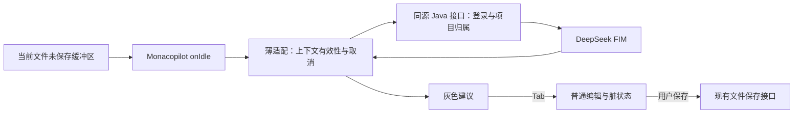

# Monaco AI Tab 补全最小适配设计

日期：2026-11-15。目标分支：`codex/ai-tab-completion`。规划时 HEAD：`6eec29f9f82c0a21302d9c625b3a67d247e45bd2`，仅作本次调查身份，不作为未来执行的固定基线。

状态：设计与计划已完成自检；业务实现、正式接入验证、发布均为 `NOT_RUN`。用户已确认本文列出的产品取舍；本文不是已实现或已验收声明。

## 1. 从第一性原理限定目标

用户需要的是：编辑当前文件时获得可选择的代码建议，按 Tab 后继续原有编辑、撤销和保存流程。因此最小闭环只有四件事：取得光标前后文、请求 FIM、在正确的编辑位置显示建议、接受后成为普通编辑。建议不是自动执行任务，不直接写服务器文件，也不保证生成代码必然正确。

推荐：**Monacopilot 1.2.12 前端 + 一个码瑙 Java FIM 接口 + DeepSeek**。复用现有编辑器、登录态、项目归属校验、脏状态和保存合同。

| 路线 | 收益与代价 | 决定 |
| --- | --- | --- |
| Monacopilot 薄适配 + 现有 Java 后端 | 复用触发、灰字和 Tab/follow-up；只补码瑙生命周期与 FIM 协议 | 采用 |
| 自写 Monaco inline provider | 可完全控制文本范围，但要维护更多交互；目前没有必须重写的需求 | 不采用 |
| Fork Monacopilot 或新增 Node 代理 | 可修改库内部、复用其服务端 SDK，但增加长期维护或部署单元 | 不采用 |



## 2. 已确认范围与明确取舍

1. 码瑙统一配置 DeepSeek Key 和补全模型，不使用个人聊天模型配置。
2. 默认自动补全，不增加设置界面；`trigger: 'onIdle'`，沿用库的 400 ms 防抖；保留 follow-up。
3. 首版只使用当前文件的未保存缓冲区；不抓取其他文件、聊天记录或项目索引。
4. 不做用户限流、全局并发限制、配额、队列、自动重试、熔断或新缓存。取消被新输入取代的旧请求属于编辑正确性，不是限流。
5. 后端单次模型调用最多等待 5 秒；超时放弃本次建议，不弹窗、不影响输入；首版不设硬性延迟门槛。浏览器可有 6 秒防悬挂截止时间，其包含应用网络余量，不等同于模型超时。
6. 已知 Python 多行换行/插入范围问题暂缓修复；继续允许多行建议，不增加语法验证器、换行启发式或库补丁。历史事实仍为 `FAILED`，本次修复要求为 `WAIVED_BY_USER`。
7. 既有 `Canceled` 异常保留记录，仅在阻断补全或出现新增异常时调查。根因仍未知；不全局屏蔽异常，不把历史失败改成通过。
8. 只在现有可写 Monaco 编辑面启用；只读、Agent/Run 导致的写锁、无模型、无焦点或非空选择区时不请求建议。大文件降级的 PlainTextEditor 和其他审阅编辑器不接入。

## 3. 现有代码与证据

| 依据 | 对方案的约束 |
| --- | --- |
| `poc4/frontend/src/components/files/WritableMonacoEditor.tsx` | 复用 Monaco model、`keepCurrentModel`、Ctrl+S 和 buffer registry；注册适配器，不接管保存 |
| `poc4/frontend/src/components/files/EditorWorkspace.tsx` | 当前文件通过 `key={visibleActivePath}` 挂载，`readOnly={writesLocked}` 已统一传入；无需重构工作台 |
| `poc4/frontend/src/api/httpClient.ts` | 已支持相对 `/api/v1/`、Bearer、AbortSignal 与 401 会话清理；不重复写 HTTP 层 |
| `ProjectService.get(ownerId, projectId)`、`SecurityConfig` | 现有项目归属查询与 `/api/**` 鉴权可复用；不新增授权框架 |
| Monacopilot 1.2.12 `register.ts` / `processor.ts` / `request-completion.ts` | 注销方法是 `deregister()`；provider 绑定注册时语言；上下文在防抖前构建；取消不保证停止已开始请求；默认缓存全局共享 |
| [上一轮验证](../../../poc4/docs/evidence/ai-tab-completion/2026-11-15-validation.md) | 短补全、Tab、follow-up 与局部取消适配已有探针证据；正式工作台与 Java 接口未验证 |

本轮读取关联聊天「tab补全验证」及磁盘证据，但未重跑模型或浏览器。历史 15 次 HTTP 200 不能解释为 15 项正确性通过；0.7–1.0 秒仅是少量合成短样本。CodeGraph 对本工作树提示来自主 checkout，因此产品代码依据另以目标工作树磁盘内容核对。

## 4. 最小接口与配置

`POST /api/v1/projects/{projectId}/code-completions`

```json
{"prefix":"def add(a, b):\n    return ","suffix":"\n"}
```

```json
{"completion":"a + b"}
```

空建议为 `{"completion":null}`。请求只传两个非 null 字符串，允许空字符串；每侧最多 16,000 个 UTF-16 code units。前端先沿用 `maxContextLines: 100`（库在无 relatedFiles 时前后各最多 50 行），再保留 prefix 尾部、suffix 头部各 16,000 单位；截断处不要拆开代理对。该长度边界限制单次上下文，不限制调用频率。

不发送 Key、模型名、模型 URL、ownerId、完整 Monacopilot metadata 或文件路径到该接口。FIM 仅需要 prefix/suffix，projectId 只用于既有资源归属校验。后端不读取 workspace 文件，不检查文件 revision，不新建 AgentTask 或持久化补全记录。

服务端顺序：现有 JWT 鉴权 → `ProjectService.get(authentication.getName(), projectId)` → 非本人/不存在返回现有 `404 ENTRY_NOT_FOUND` → 非 READY 返回空建议 → 配置检查 → 模型调用。项目写锁继续由原编辑/保存合同负责；补全请求不获取锁，更不能在等待模型的 5 秒内占用项目锁。

使用一个复用的 JDK 17 `HttpClient` 和已有 Jackson，不增加 Java SDK。生产端点固定为 `https://api.deepseek.com/beta/completions`；测试通过构造参数注入本机假服务 URI，不将 URL 开放给浏览器。

| 环境配置 | 默认值 / 行为 |
| --- | --- |
| `MANAO_FIM_API_KEY` | 空；空时返回空建议，不影响整个平台启动 |
| `MANAO_FIM_MODEL` | `deepseek-flash`，平台部署配置可覆盖 |

其余先用代码常量：`max_tokens: 256`、`temperature: 0`、`stream: false`、连接超时 2 秒、单请求截止 5 秒。请求设置 `prompt=prefix`、`suffix=suffix`；不设置换行 stop、不包裹聊天提示、不 trim 前后文。取 `choices[0].text` 原样交回 Monacopilot；空 choices/null/空字符串转空建议，非字符串视为协议错误。Monacopilot 后续的格式化仍保留其已知限制。

上游超时/非 2xx/网络或 JSON 协议异常映射为固定 `503 AI_MODEL_UNAVAILABLE` / `502 AI_MODEL_PROTOCOL`；不回传供应商原文、Key 或代码。记录固定错误类别和耗时足够，不建立指标系统或保存源码日志。前端把请求错误转空建议，401 仍执行现有 HttpClient 的会话清理。缺 Key、非 READY 或空结果返回 200/null，与模型故障状态可区分。

## 5. 前端生命周期：只保留必要状态

增加一个 `registerTabCompletion(...)` 普通函数模块；返回一个清理函数。组件 effect 在 editor 已挂载且可写时注册，依赖 editor、projectId、path、language、readOnly，变化时先清理再重建。适配函数内部的 `syncRegistration()` 只在实际 model URI/语言与传入身份一致时注册；model/语言事件先清理旧注册，再执行该同步函数。不匹配时等待后续事件，不能把旧 model 当作新文件。卸载只注销补全，不销毁由原工作台管理的 model。

注册显式设置 `enableCaching: false`、`allowFollowUpCompletions: true`、`trigger: 'onIdle'`、`maxContextLines: 100`。沿用库的 Tab、Esc、灰字、格式化和范围行为，不新增通用 editor 插件管理器或自定义 Tab 快捷键。

适配器只持有当前请求的 AbortController、递增序号、disposed 标记和几个监听器：

- 发送前验证当前 model/URI、可写、焦点、空选择区，以及 metadata 的 cursorPosition 和前后文本仍对应当前缓冲区。库在 400 ms 前生成的旧 metadata 不可配上新的快照冒充有效请求。
- 校验后捕获 model 对象与 URI、`getVersionId()`、光标、序号；只发送经过长度裁剪的 prefix/suffix。
- 内容、光标/选择区、model/语言、焦点改变，Esc、只读或组件卸载时使旧请求失效；AbortController 尽力取消网络。model/语言改变还应注销旧 provider；下一次可用注册绑定实际新语言。
- 返回时再次核对 disposed、序号、signal、model/URI、版本、光标、可写及焦点；任何不符返回 `completion:null`。检查 AbortSignal 的同时保留序号校验，避免依赖网络一定支持取消。
- `finally` 只清理属于该请求的 timer/controller，旧响应不能清掉新请求。清理调用 `deregister()` 并释放全部监听器、timer。

浏览器中止不保证 Java 或上游模型即时停算或停止计费；首版用后端 5 秒截止收束调用，不开发跨服务取消协议。用户按 Tab 后产生的是普通 model 编辑，dirty、Undo、Ctrl+S、revision/冲突处理均走原路径。

## 6. 验收口径

| 层次 | 必须证明 | 不可替代的下一层 |
| --- | --- | --- |
| 后端合同 | 归属校验在模型请求前；FIM 映射、超时、错误、空配置正确 | 不证明编辑器能显示建议 |
| 前端生命周期 | 旧结果不显示、只读不请求、注销不泄漏、follow-up 不被误关 | 不证明真实 Monaco 交互 |
| 实际工作台 + 固定补全 | 自动灰字、Tab、Esc、Undo、dirty、保存重开、切文件/项目/语言 | 不证明真实 DeepSeek 或云端 |
| 实际工作台 + Java + DeepSeek | Java/Python/TypeScript 的短补全各一次，真实网络记录与保存重开 | 不作复杂代码质量或 p95 保证 |
| 云端增量冒烟 | 同一候选构建从部署后的真实浏览器完成一次上述链路，本地开发服务关闭 | 未运行时云端状态为 NOT_RUN |

固定补全回归覆盖交错响应、同前缀不同项目、只读切换、Esc 时请求尚未返回、无建议时 Tab 缩进与已有建议菜单共存。若既有 `Canceled` 再现，保留错误栈和功能断言；只有确认同类且不阻断功能才能按已确认例外记录，新增异常单独失败处理。

换行问题历史结果保留 `FAILED`，本次要求 `WAIVED_BY_USER`；不通过跳过测试伪造全绿，也不为这项已暂缓的缺陷增加修复任务。实现、固定响应浏览器验证、真实模型验证、云端验证分别记录。当前请求只授权规划，不执行部署、模型调用或验收。

## 7. 自检与信心边界

- 范围覆盖：自动补全、统一 Key/model、follow-up、5 秒等待和两项已知问题处理均有明确合同。
- 最小性：前端一个功能模块加一个 API 文件；后端一个 Controller、一个具体 Client、一个配置类。没有 service/interface/repository/provider registry 等只为分层而增加的对象。
- 保留必要复杂度：JWT/项目归属保护既有资源边界；取消、版本与 model 校验防止建议落到错误文件；关闭全局缓存消除已复现的跨项目命中。
- 删除无需求设计：设置页、跨文件/RAG、缓存重建、流式传输、性能调优、限流、模型多供应商适配、库 fork、自动语法修复、Agent/Run 新状态、数据库迁移。
- 主观工程把握：薄适配架构约 90%；生命周期方案约 80%，仍须正式 Monaco 回归。数字不是测试通过率。实际云端延迟、复杂代码质量和 `Canceled` 根因不作 75% 以上判断，分别由实测和已确认范围取舍处理。
- 用户已回答的低把握选择：默认开启且无设置页；5 秒超时并不设硬性延迟门槛；既有 `Canceled` 非阻断时暂不调查。没有剩余必须靠用户决策才能写完计划的事项。

后续执行见[三任务实施计划](../plans/2026-11-15-ai-tab-completion.md)。执行前重读最新文件；若必须更换库、引入额外服务、修复已豁免问题或扩大上下文范围，应先说明新证据并确认范围。

参考：[Monacopilot custom request handler](https://monacopilot.dev/advanced/custom-request-handler.html)、[DeepSeek FIM](https://api-docs.deepseek.com/guides/fim_completion/)、[DeepSeek completions API](https://api-docs.deepseek.com/api/create-completion/)。本轮通过 Context7 获取接口资料，并以本地 1.2.12 源码核对生命周期方法。
