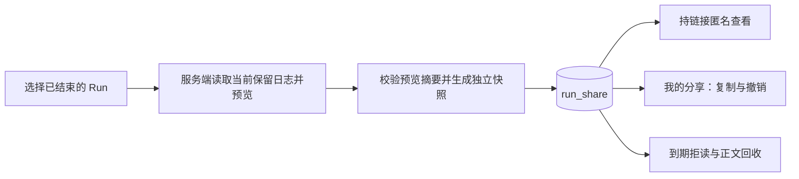

# 运行结果分享设计

日期：2026-11-16。状态：Task 1–5 独立审查 PASS，最终整分支 READY、零未关闭发现；本地真实闭环及精确资源/服务/测试schema收尾 PASS。默认标题修正后的真实E2E NOT_RERUN，旧通过快照与前两轮失败保留，云端发布 `NOT_RUN`。当前证据和环境限制见[验收记录](../../../poc4/docs/evidence/run-result-sharing/acceptance.md)。

调研基线：主 checkout 的 `master` / `16022d2`。文档分支：`codex/run-result-sharing-plan`。后续实施以实际 checkout 为准，重新核对迁移序号，不把此 SHA 作为永久基线。

## 1. 目标与已经确认的边界

用户要把一次代码运行的结果交给别人查看。接收者不需要进入工作台，也不需要项目仍然存在。因此分享的基本对象是一份独立、不可变、可撤销的结果快照。

本设计承接聊天“运行日志分享调研”，并以本次用户确认覆盖其中的旧建议：

| 事项 | 确定规则 |
| --- | --- |
| 分享资格 | 只按所选 Run 判断；允许 `SUCCEEDED`、`FAILED`、`CANCELLED`、`TIMED_OUT` |
| 未结束运行 | `STARTING`、`RUNNING`、`STOPPING`、`RECOVERING` 不可分享；同项目其他运行活跃不影响历史终态 Run |
| 日志范围 | 分享服务端数据库当前保留的全部日志；没有选行、浏览器窗口上传、补采或完整采集保证 |
| 截断信息 | 预览和接收页不增加截断、缺口、完整性提示，也不将内容标为“从头到尾完整日志” |
| 访问方式 | 持链接免登录只读；预览、创建、管理、撤销需要创建者登录 |
| 生命周期 | 从成功生成链接起固定 72 小时，不因访问或重试延长 |
| 源数据独立性 | 源日志清理、删除原项目均不影响已经生成的分享 |
| 空日志 | 允许分享；显示“暂无可分享的日志”，不推断是没有输出还是已清理 |
| 链接数量 | 每个 Run 最多一个仍有效的链接；再次打开管理已有链接 |
| 再次生成 | 撤销或到期后，源项目和 Run 仍存在且可读取时，可以重新生成；新链接有自己的 72 小时 |
| 失效与回收 | 到期立即禁止服务端读取；每 2 小时清理一次到期正文，允许物理回收有调度延迟；撤销时同步清空正文 |
| 操作体验 | 运行记录中有“分享结果”；预览、标题、可选说明、复制链接、本地二维码、撤销、明确失效提示 |

以下采用最小产品默认，不需要新增子系统：标题必填、预填“运行结果”、去首尾空白后 1–100 个 UTF-16 code units；说明可选、最多 2000 个 UTF-16 code units。发布后不编辑，修改内容通过撤销后重新生成。前后端使用同一长度定义。

撤销阻止其后发起的服务端读取；不对已经返回的正文、截图或复制内容做回收，也不新增实时撤销推送。已打开页面在到期时按已知 `expiresAt` 切换为过期态；后端判断始终是访问权限的最终依据。

## 2. 从约束推导最小架构

| 方案 | 是否满足目标 | 选择 |
| --- | --- | --- |
| 链接直接读取原 Run/日志 | 源日志清理、项目删除后无法持续提供内容 | 不采用 |
| 现有 MySQL 独立快照 + 现有后端接口 | 独立保留、匿名只读、撤销、到期均能在当前系统内完成 | 采用 |
| 对象存储、独立分享服务、异步生成任务 | 能完成，但增加存储、任务状态和运维边界；当前日志窗口没有这方面需要 | 首版不引入 |

新增一个 `share` 后端模块、一张表和前端分享功能目录。保留原日志采集、运行生命周期、WebSocket、Kubernetes 和项目删除流程。

二维码只编码公开页面 URL，直接在浏览器生成 SVG；不用后端图片接口或第三方二维码服务。

## 3. 现有代码能够复用什么

以下为本次源码核对结果，不是部署验证：

| 位置 | 事实及设计影响 |
| --- | --- |
| [RunPanel.tsx](../../../poc4/frontend/src/components/runs/RunPanel.tsx) | `selectedRun` 与 `activeRun` 分离；入口绑定 `selectedRun`，不复用“能否启动运行”的权限条件 |
| [run.ts](../../../poc4/frontend/src/contracts/run.ts) | `isRunTerminalState` 已有四种终态判断 |
| [JdbcLogStore.java](../../../poc4/backend/src/main/java/com/manao/poc4/log/JdbcLogStore.java) | `loadChunks(runId)` 单次查询按 `seq` 读取全部当前保留 chunks，可直接复用 |
| [RunLogWindow.java](../../../poc4/backend/src/main/java/com/manao/poc4/log/RunLogWindow.java) | 正常日志窗口为 5 MiB；分享不增加第二次裁剪，直接复制实际读到的内容 |
| [RunLogService.java](../../../poc4/backend/src/main/java/com/manao/poc4/log/RunLogService.java) | 内存窗口可能比数据库清理后的内容更旧，不能作为快照权威源 |
| [RunObservationService.java](../../../poc4/backend/src/main/java/com/manao/poc4/run/RunObservationService.java) | 正常收尾先补采日志再落终态；本功能不强化为“采集绝对完整”合同 |
| [RunStore.java](../../../poc4/backend/src/main/java/com/manao/poc4/run/RunStore.java)、[RunPolicy.java](../../../poc4/backend/src/main/java/com/manao/poc4/run/RunPolicy.java) | `findRunForOwner` 和持久化 `policyJson` 提供运行事实；环境使用该次运行的快照 |
| [WorkspaceJdbcStore.java](../../../poc4/backend/src/main/java/com/manao/poc4/workspace/WorkspaceJdbcStore.java)、[ProjectDeletionRepository.java](../../../poc4/backend/src/main/java/com/manao/poc4/project/ProjectDeletionRepository.java) | 项目删除使用 project 行锁，并删除源 Run/日志；分享创建沿用该锁顺序，分享表不参与源数据删除 |
| [RuntimeMaintenanceLoop.java](../../../poc4/backend/src/main/java/com/manao/poc4/config/RuntimeMaintenanceLoop.java) | 已有独立保护的维护调度；增加每 2 小时一次的分享回收，不改变源日志七天规则 |
| [AppRouter.tsx](../../../poc4/frontend/src/app/AppRouter.tsx)、[httpClient.ts](../../../poc4/frontend/src/api/httpClient.ts) | 有保护路由和 `auth:false`；公共页面放在 `RequireAuth` 外，公开请求不携带登录令牌 |
| [AccountPanel.tsx](../../../poc4/frontend/src/components/shell/AccountPanel.tsx) | 项目列表与工作台复用的账户入口，适合新增“我的分享” |
| [nginx.conf](../../../poc4/frontend/deploy/nginx.conf) | 已有 SPA fallback；无需为 `/shares/:token` 新增独立部署服务 |

## 4. 数据与公开合同

### 一张独立表

`run_share` 的字段分为三个用途，仍在同一表内：

- 身份与归属：`id`、`owner_id`、`source_project_id`、`source_run_id`、`source_project_name`、随机 `token`。
- 快照正文：`title`、`description`、`run_snapshot_json`、`log_text`。
- 生命周期和重试：`created_at`、`expires_at`、`revoked_at`、`request_id`、`request_digest`。

`source_project_id` / `source_run_id` 只用于创建时定位和 owner 管理，不建外键，不参与公开读取 JOIN。表本身不依赖源项目、Run 或日志行存活。

`log_text` 使用 `LONGTEXT`，保存各 chunk 文本按 `seq` 拼接的原值；不 `trim`、不补换行。选择文本列避免整段日志因 JSON 转义膨胀而碰到 `TEXT` / `MEDIUMTEXT` 边界。传输中的 JSON 膨胀和数据库单包大小通过接近实际 5 MiB 窗口的集成用例验证，不声称新增长度限制。

`token` 为 `SecureRandom` 生成的 32 字节、无 padding 的 Base64URL（43 字符），大小写敏感并唯一。与 owner 管理使用的 `id` 分离；公开请求只凭此 token 读取该快照。

到期回收清空 `log_text`、`description`、`run_snapshot_json`；撤销在同一个事务中记录撤销状态并清空上述字段。保留标题、来源名称、归属、token、时间和请求摘要等小型记录，用来显示失效原因、支持 owner 列表和防止旧请求重新生成链接。首版不另建归档表。

### 精简展示快照

公开运行摘要仅含：`state`、`exitCode`、`createdAt`、`startedAt`、`finishedAt`、`language`、`runtimeLabel`。加上标题、说明、日志、分享创建与到期时间构成公开页面内容。

- `language` 覆盖 `java` / `python` / `javascript` / `typescript`。
- `runtimeLabel` 由 `RunPolicy.fromJson(run.policyJson())` 的运行时字段构造，支持历史 Java 行；不以项目当前模板或平台当前版本替代。
- 不公开整个 `RunRecord` / `RunPolicy`，不增加账号信息、源码、环境变量、资源名、内部地址、日志截断字段。
- `exitCode = null` 显示“未产生退出码”；开始时间为空显示“未开始”；耗时只有起止时间都存在才计算。
- 标题、说明和日志按纯文本呈现，不解释 HTML、Markdown 或终端控制命令。

### 接口

统一使用相对 `/api/v1/`，创建请求不接受日志正文、运行摘要、owner、有效期或分享 URL。

| 方法与路径 | 权限 | 合同 |
| --- | --- | --- |
| `GET /projects/{projectId}/runs/{runId}/share-preview` | owner | 有有效分享则返回 `EXISTING` 和管理摘要；否则返回 `PREVIEW`、快照和 `snapshotDigest` |
| `POST /projects/{projectId}/runs/{runId}/shares` | owner | 入参 `requestId, snapshotDigest, title, description`；创建返回 201；同请求重试返回 200 和原记录当前状态 |
| `GET /run-shares?limit=20&before=...` | owner | 仅当前用户记录；按 `created_at DESC, id DESC` 游标分页；limit 上限 50；不返回日志大字段 |
| `DELETE /run-shares/{shareId}` | owner | 幂等撤销并同步清正文，204；已过期记录也同步清正文，但保留“已过期”原因 |
| `GET /public/run-shares/{token}` | anonymous | ACTIVE 返回快照；过期/撤销返回 410；不存在返回 404 |

`EXISTING` / 创建响应和 owner 列表使用相同管理摘要：`id, title, sourceProjectName, createdAt, expiresAt, status, sharePath`；只有 ACTIVE 有 `sharePath`。公开页面路径为 `/shares/{token}`。

主要固定业务错误：`RUN_SHARE_NOT_TERMINAL`、`RUN_SHARE_PREVIEW_CHANGED`、`RUN_SHARE_ALREADY_ACTIVE`、`RUN_SHARE_REQUEST_MISMATCH`（409），`RUN_SHARE_EXPIRED`、`RUN_SHARE_REVOKED`（410），`RUN_SHARE_NOT_FOUND`（404）。不存在与非 owner 的私有资源使用一致的 404；未登录沿用 401。参数校验、项目处于删除态和运行策略损坏分别沿用现有固定错误习惯，不透传内部异常。

仅开放 public GET 的精确匹配规则；owner 路径仍由当前认证链保护。公开结果、失效响应及包含正文的预览返回 `Cache-Control: no-store`；页面不把日志写入 localStorage、IndexedDB 或持久化查询缓存。

## 5. 预览、发布与竞态

不保存草稿。预览返回内容和摘要，发布时复读并比较：

1. 按 owner 校验 project 和所选 Run，拒绝处于删除流程的项目，验证该 Run 终态。
2. 直接 `JdbcLogStore.loadChunks` 一次读当前数据库保留集合，拼接成日志，构造不可变快照。
3. 对包含来源 project/run ID、固定字段顺序、明确 null 的快照编码计算 SHA-256。摘要不包含当前时钟、标题说明或尚未创建的分享 ID。
4. 用户确认后 POST。先按 `(owner_id, request_id)` 查已有结果并校验请求摘要；相同请求直接返回原记录当前状态，源项目已经删除也能找回结果。
5. 没有旧结果时，在短 JDBC 事务中尝试锁 owner 的 project 行；即使已缺失或 DELETING，也先复查一次请求结果再决定拒绝新建。这样“第一次查收据后原发布提交，接着项目删除”的重试仍可找回原结果。没有旧结果才校验项目/Run，检查该 Run 是否已有 ACTIVE 分享。
6. 已有其他有效分享返回 `RUN_SHARE_ALREADY_ACTIVE`，前端重新查询预览进入已有链接管理；不覆盖已有标题或说明。
7. 复读并仅构造一次不可变快照，用同一个对象完成摘要比较和 INSERT。不同则返回 `RUN_SHARE_PREVIEW_CHANGED`，保留标题说明并重新展示预览，必须再次点击生成。
8. 一次提交随机 token、快照、请求摘要和时间；生成时间使用数据库时间，`expires_at = created_at + 72h`。失败事务不留下半份分享。

创建按 project 行锁串行，与项目删除使用同一锁顺序，避免重复有效分享和“删除一半时创建”。创建先提交则快照独立存活；删除先开始则拒绝新建。源日志清理可并发，单条日志 SELECT 提供一个一致可见集合，无需锁住整个日志表。

唯一约束 `(owner_id, request_id)` 处理同请求并发；请求摘要包含来源 ID、`snapshotDigest`、规范化标题说明。同键不同参数拒绝。同键结果即使已撤销或过期也不能重新发布；真正重新生成使用新 requestId。网络超时保留原 requestId，不自动换键重发。

## 6. 生命周期和页面

ACTIVE 定义为 `revoked_at IS NULL AND databaseNow < expires_at`。到期相等时已经无权读；缺失正文的“有效记录”属于数据错误，不能伪装成合法空日志。合法空日志存储为 `''`，回收后使用 `NULL`。

公开读取在一个数据库语句中判定状态，只有 ACTIVE 才选择快照大字段；过期/撤销响应不返回正文。清理停摆也不会延长访问。定期回收每 2 小时执行一次，使用一个独立、可重入的 UPDATE；与现有七天源日志清理分别调度。正常运行时，到期正文通常额外保留 0～2 小时，任务耗时或故障可能延长回收等待，但不会延长 72 小时的访问有效期。

前端范围：

- **运行记录**：文字按钮绑定选中的 Run。打开弹窗后固定 Run ID；切换工作台中的 Run 不串改弹窗上下文。
- **分享弹窗**：加载预览 → 填标题说明 → 生成 → 链接、二维码、到期时间和撤销。存在 ACTIVE 链接时直接展示管理态。说明“持有链接的人可查看”，不加入额外确认向导。
- **公开结果页 `/shares/:token`**：独立轻量页面，共享预览的展示组件；loading、正常、过期、撤销、不存在、网络失败分别处理。不查询项目，不申请日志 ticket，不连接 WebSocket。
- **我的分享 `/account/shares`**：账户菜单入口，登录保护；按 owner 分页列出记录，显示状态、到期时间，ACTIVE 可复制和撤销。源项目删除后仍然可操作，不要求回到项目。
- **二维码/复制**：本地 `QRCodeSVG`；链接为当前公开站点 origin 加服务端返回的 `sharePath`。剪贴板失败可选择文本手动复制；预览使用的 localhost 地址只用于本地测试。

大日志先使用完整文本、固定高度、滚动的简单展示；不要逐行创建数万个 React 元素。5 MiB 用例若实际出现不可接受卡顿，再在展示层引入分块渲染，不能以性能为由静默裁剪分享内容。

## 7. 验收与刻意限制

必须证明：终态/非终态边界；当前运行不阻止历史分享；空日志合法；数据库全部保留日志原样复制；预览摘要变化不发布；并发点击只有一个有效链接；重试不续期；源清理和项目删除后仍可匿名读取及 owner 撤销；72h 边界和清理失效分离；失效记录正文为 NULL；非 owner 无权管理；公开输出只含白名单字段。

保留一条真实后端与浏览器闭环作为交付验收：登录创建者生成 → 无登录上下文访问 → 删除源项目后继续访问 → “我的分享”撤销 → 匿名刷新失效。精确 72h 边界用可控时钟/数据库集成测试验证，不让测试实际等待三天。

首版不增加选行、编辑发布内容、密码/权限名单、社交发布、访问统计、日志搜索系统、PDF 导出、短链服务、完整日志采集、草稿状态机或新基础设施。

## 8. 实施入口与文档依据

- [五任务实现计划](../plans/2026-11-16-run-result-sharing.md)。本轮只整理文档，不执行其中代码、迁移、服务启动或部署步骤。
- Spring 事务用法已通过 Context7 核对：[TransactionTemplate](https://docs.spring.io/spring-framework/reference/data-access/transaction/programmatic.html)、[JdbcTemplate 与同一 DataSource 的事务连接](https://docs.spring.io/spring-framework/reference/data-access/jdbc/connections.html)。沿用 Java 17，不采用需开启 preview 的模式匹配 switch。
- 二维码用法已通过 Context7 核对：[qrcode.react / QRCodeSVG](https://github.com/zpao/qrcode.react/blob/trunk/_autodocs/api-reference/QRCodeSVG.md)。只增加此直接依赖，使用 pnpm。

产品关键歧义已在本次对话中确认。方案把握高；性能、迁移和实际浏览器行为仍须按计划验证，不能由本设计推定已经通过。
