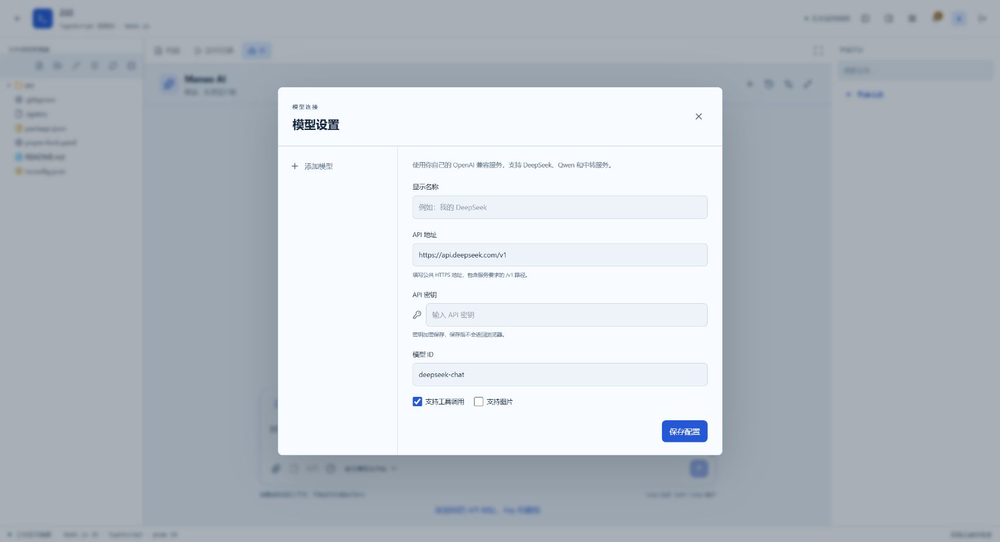

# HTTP UUID 最小修复发布与浏览器验证（2026-11-14）

结论：**DEPLOYED / HTTP_UUID_BROWSER_SMOKE_PASS**。frontend 已滚动更新并 Ready，真实普通 HTTP 入口的模型配置弹窗、添加模型入口和新建会话通过冒烟验证。当前账号没有个人模型，保存真实凭据、真实聊天与任务审阅未运行；不授予完整 Studio 浏览器验收 PASS，不改写 [2026-11-12](cloud-20261112.md) 的历史失败。

## 发布身份

- 发布时的工作分支：`codex/fix-studio-http-uuid`，基于 `df13e3e962b282a5e751a9be33501b29c5ee88a5`，修复在构建时尚未提交。镜像从该独立工作树直接构建，包含新增 `src/lib/uuid.ts` 和三个 Studio 组件的五处调用替换；不能将基线 SHA 描述成已包含修复的提交。
- 构建：使用既有 `poc4/frontend/Dockerfile`，`linux/amd64`，`VITE_ENABLE_AI=true`，mock 与实验终端关闭；容器内 `pnpm build` 含类型检查通过。镜像中实际静态资源提取后通过浏览器边界检查，随后删除本地提取副本。
- 镜像 tag：`chocologic/manao_images_repository:studio-http-uuid-20261114-df13e3e`。
- 部署引用：`chocologic/manao_images_repository@sha256:748be9e6f7a74458ef7787cfe0d8bbd09d7be5e4a0c2fe74d2f433fef1a0642e`。
- Linux manifest：`sha256:c3c6d17a1a93f64a2b4ba4d5380ce659b28faedeb5dd63cc5b65aa751064d672`；部署使用包含该 manifest 的不可变 OCI index digest。
- 入口：`http://1.12.245.235:30080`；context `kubernetes-admin@learn`，namespace `manao-stage6b`；所有管理命令固定 `--server=https://127.0.0.1:6443`。
- 三个节点 Ready；仅 `frontend` 从 generation 45 更新到 46。新 Pod `frontend-fbc57bc9d-6xp95` Ready，imageID 与部署 digest 一致，初次验证重启数 0。
- backend / Worker 分别保持 generation 71 / 51，镜像仍为 `sha256:b4d35fbafa4054d24db287a5944e0ceafd9da68ab90932d52d37d0475ae72eea` / `sha256:84ff2ed7b916fb32df96a4f78d80ef9b99de6187ad9048c546e891f19f605997`。未执行 schema migration、Secret 修改或 workspace/runner 更新。
- 平台 MySQL PVC `data-mysql-0` UID `d6b6bc54-6e34-4bac-9897-436cf9e84cb3`，Bound；发布前已保存旧镜像引用和修复源码 SHA256，私有记录不进入 Git。

## 已完成的实测

| 场景 | 结果与证据范围 |
| --- | --- |
| 发布前复现 | FAILED：用户登录后的真实 HTTP 项目页面点击“添加你的 API 地址、Key 和模型”，出现“页面出现异常”；实际日志 `crypto.randomUUID is not a function` |
| 镜像构建与发布 | PASS：类型检查、Vite 构建、镜像资源边界检查、上传和远端 digest 核对 |
| 滚动更新 | PASS：`kubectl rollout status deployment/frontend` 成功；实际 Pod imageID 匹配 |
| 公网首页与 API | PASS：首页和 `/api/v1/auth/options` HTTP 200，首页 `Cache-Control: no-cache`，入口脚本更新为 `index-DmggZ-H0.js` |
| 真实 HTTP 能力检查 | PASS：浏览器实际 `isSecureContext=false`，`typeof crypto.randomUUID='undefined'`，`typeof crypto.getRandomValues='function'`，未注入兼容补丁 |
| 模型配置弹窗 | PASS：同一真实项目的“添加你的 API 地址、Key 和模型”打开正常表单，不再进入整页错误；初始没有任何个人模型 |
| 添加模型入口 | PASS：弹窗中的“添加模型”正常执行并保留可编辑表单；未填入或保存任何 API Key |
| 侧栏布局 | PASS：切到右侧面板后再次打开配置弹窗并点击“添加模型”，页面正常 |
| 新建会话 | PASS：一次 POST `/assistant/conversations/8b142d0e-bfb4-4b6b-a05c-080cc8cf91ac` 返回 200；后续会话列表、turns 查询返回 200，界面出现“新会话” |
| 保存真实模型、真实聊天与任务审阅 | NOT_RUN：当前账号没有个人模型；本轮不新增凭据、不调用真实模型，不将前轮 mock 结果扩大为本轮云端通过 |

刷新新版本后应用返回登录页，用户重新登录后完成上述检查。本轮没有创建测试项目、模型、任务或 Run，没有修改既有项目源码；在用户原项目中保留上述一个空会话供继续使用。最终 frontend / backend / Worker 均 Ready 1/1，平台 MySQL PVC UID 保持原值且 Bound。用于镜像检查的本地容器和静态资源提取副本已删除；保留发布摘要、请求状态证据和以下截图。



## 回滚

本轮未触发回滚。必要时仅恢复 frontend 旧镜像，继续经原隧道管理：

```powershell
kubectl --server=https://127.0.0.1:6443 --context kubernetes-admin@learn -n manao-stage6b set image deployment/frontend frontend=chocologic/manao_images_repository@sha256:10bce3fd3f9c93fefa3df761023c1ea3be45321f0933dc855810af3a790c37fb
kubectl --server=https://127.0.0.1:6443 --context kubernetes-admin@learn -n manao-stage6b rollout status deployment/frontend --timeout=60s
```
